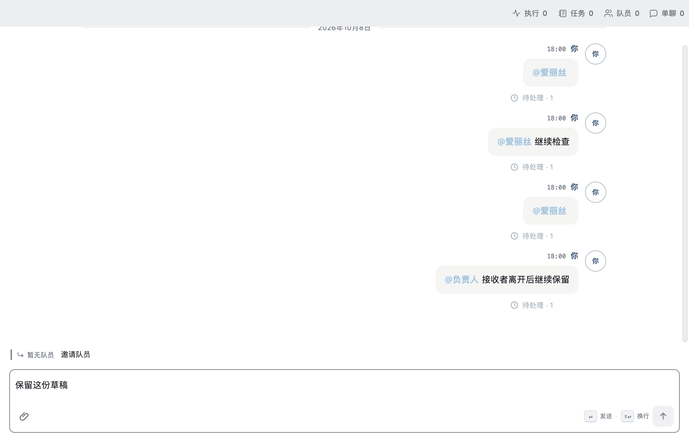
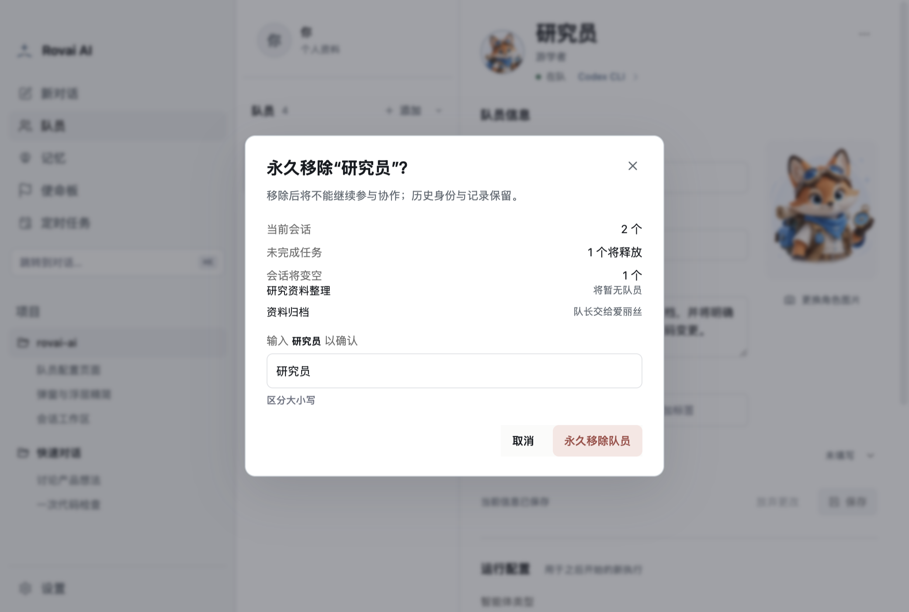

# 空会话与永久移除验收

2026-10-13 的生产组件隔离验收截图，用于 PR 视觉对照。合成投影不包含真实用户数据，也不调用真实 Runtime。

- `node --test scripts/lib/composer-invitations.test.mjs` 验证删空后的草稿与历史保留、邀请失败重试、显式接收者修复和不自动发送。设置绝对路径 `ROVAI_INVITE_EVIDENCE_DIR` 可保留截图。
- `ROVAI_KEEP_MEMBER_EDITOR_FIXTURE=1 node --test scripts/lib/member-editor.test.mjs` 验证中文名称确认、受影响会话、运行中阻断和刷新重试，并打印截图目录。

