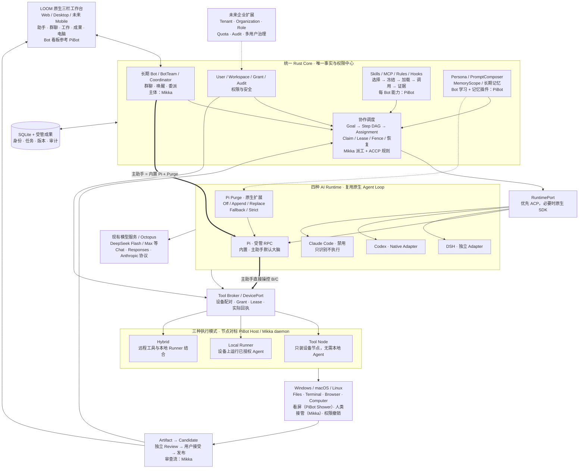

# LOOM 架构计划书（唯一现行版）

> **现行文档 · 2026-11-18 起生效。** LOOM 计划只认三份：本页（架构）、[LOOM-HANDOFF.md](LOOM-HANDOFF.md)（交接与施工规则）、[LOOM-ACCEPTANCE.md](LOOM-ACCEPTANCE.md)（验收）。参考项目的固定版本在 [LOOM-V2-REFERENCE-LOCK.md](LOOM-V2-REFERENCE-LOCK.md)；实际进度只看根目录 [LOOM-IMPLEMENTATION.md](../../LOOM-IMPLEMENTATION.md)。旧计划书全部在 [archive/plans-2026-11-18](archive/plans-2026-11-18/README.md)，只作溯源，不作施工依据。
>
> 本页不记录完成度。写着“目标”的地方都不等于已交付。

## 0. 一句话

**LOOM = 一个永远在的 Bot ＋ 可换的大脑 ＋ 可连的多台电脑 ＋ 统一的能力/记忆/授权。**

骨架照 **Mikka（怎么协作）＋ PiBot（怎么落到每台设备）** 来做；**内置 Pi ＋ Pi Purge 是主助手**；UI 就是现在的 `loom-native`，不重做。其余参考项目只取零件。

## 1. 已拍板（工兵不得改）

| # | 决定 | 含义 |
|---|---|---|
| 1 | **UI 不动** | `loom-native` 左中右三栏、配色、助手、群聊、工作/资产/流程/电脑、用户指定的粉发绿眼猫耳品牌。只换数据服务适配，不重画。 |
| 2 | **Mikka + PiBot 是主体** | Bot/群聊/唤醒/派工/审查照 Mikka；中心管 Bot 与能力、设备本地执行、Bot 看板、虚拟屏、Bot 学习与记忆插件照 PiBot。两者源码直接复用。 |
| 3 | **其余只是参考** | ACCP、DSH 内部机制、DeskFleet、MindFS、UFO³、AgentDock、agent-purge、ROVAI、AgenTeam、MOVO：取具体零件或规则，不当骨架。 |
| 4 | **主助手 = 内置 Pi + Pi Purge** | LOOM 自带、开箱即用；Pi Purge 给主助手人格/提示词。主助手既能**直接操控 B/C 电脑**（经 Tool Broker），也能**把活派给四个运行端**。 |
| 5 | **只有四个运行端，Claude Code 禁用** | Pi、DSH、Codex、Claude Code。ACP 是线协议，ACCP 是协作规则来源，都不是第五个运行端。**Claude Code 只识别、不执行**（用户 2026-11-18 拍板：自动化开发调用 Claude CLI 容易封号）；开发与测试也不得调用 Claude CLI。 |
| 6 | **一个 Core，一个库** | Rust Core + SQLite 是唯一事实与权限中心。不另跑 Mikka 的 Postgres，不另起 PiBot Center，不建第二套调度或数据库。 |
| 7 | **四能力一处勾选** | Skill / MCP / Rule / Hook；记忆是独立第五层。勾选 ≠ 加载 ≠ 真调用，后两步要运行端回执。 |
| 8 | **电脑和大脑分开** | B/C 可以只装 LOOM Node（文件/终端/浏览器/屏幕），不强制装任何 Agent；重活再选装本地 Runner。 |
| 9 | **人格不扩权** | 换人格、换大脑都不改变 Bot 身份与授权；Pi Purge Strict 只在隔离实验用。 |
| 10 | **开源直接用，可以整段照抄** | 参考快照许可已统一为 MIT。Mikka、PiBot 等上游代码可以整段照抄/移植/原样运行，保留版权与出处即可；LOOM 只写最薄适配层（规则见交接书 §2）。 |
| 11 | **开发在 DE-BERO 沙箱** | 在 DE-BERO 独立容器里模拟用户环境开发与跑测试，不碰用户电脑上的服务、数据和全局配置；Windows 专属部分（桌面安装、Windows 电脑控制）仍在用户电脑隔离验收。 |

## 2. 架构图

基于用户确认的商量版，只加了来源标注和主助手两条线。



## 3. 每一层直接用什么（复用总表）

路径相对各参考仓库根；版本见 [参考锁](LOOM-V2-REFERENCE-LOCK.md)。Mikka 本机镜像 `_artifacts/reference-repos/mikka-current`，PiBot 本机镜像 `../_references/pibot`。“LOOM 只写”是允许新增的全部范围，超出就是造轮子。

| 层 | 主体来源（直接复用） | 参考零件 | LOOM 已有、要对齐的 | LOOM 只写 |
|---|---|---|---|---|
| **Bot / 群聊 / 唤醒** | Mikka `lib/coordinator/group-routing.ts`、`group-turns.ts`、`group-factory.ts`、`route-group.ts`、`wake-after-commit.ts`、`wake.ts`、`wake-recovery.ts`、`lease.ts`；术语 `docs/design/glossary.md`、`orchestration.md` | PiBot `host-core/group-chat-orchestrator.js`、`group-chat.js`（跨设备 Room） | `crates/rovai-core/src/teams.rs`、`collaboration.rs`、`crates/loom-protocol/src/v2_coordinator*.rs` | 把 Mikka 的路由/唤醒算法移植进 Rust Core 并接现有 Team/Thread 数据；不搬 Postgres DDL |
| **派工 / 认领 / 恢复** | Mikka `lib/factory/automatic-dispatch.ts`、`dispatch.ts`、`claim.ts`、`reconcile.ts`、`dispatch-recovery.ts`、`watchdog.ts`；`lib/computer/worker-lease.ts` | ACCP 的 claim/lease/fencing 不变量（`internal/controlplane/tasks_execution.go`） | `crates/rovai-core/src/loom.rs` 的 `claim_acquire*`、`scripts/loom-v2-runtime-file-guard.ts` | 写入前必须持有 claim + fence；把 guard 接到 Core 已有 claim，不另造 Rust 版 ACCP 服务 |
| **注意力 / 等你拍板** | Mikka `lib/attention/*`（store、score、interrupt、handoff）、`lib/coordinator/question-attention.ts`、`waiting-questions.ts` | PiBot `runtime-bot-board.js`、`bot-board-protocol.js`（需要你/工作中/待查看/空闲） | `notification*.rs` | 投影到现有 UI 的看板与右栏 |
| **成果 / 审查 / 接受** | Mikka `lib/factory/artifact-review.ts`、`check-independence.ts`、`acceptance-state.ts`、`approval.ts`、`lib/artifacts/store.ts`、`lib/project-map/graph.ts` | — | `managed_attachment.rs`、`execution_evidence*.rs` | 用户接受与发布分开（Mikka accept 会合并 PR，LOOM 不照搬这一步） |
| **每 Bot 能力（四能力）** | PiBot `host-core/plugins/manager.js`（内容指纹与授权指纹分开）、`capabilities/skill.js`、`capabilities/mcp.js`、`turn-sync.js`（prepare/confirm/restore）、`third-party/pi-skills.js` | DSH 原生 Hook / Profile；Mikka `packages/daemon/src/agents/run-context.ts`（冻结 Skill 快照） | `member_capability.rs`、`skill_projection.rs`、`mcp*.rs`、`local_hook.rs`、`resources/dsh-hook-executor` | 保存选择 / 设备准备 / 实际生效 / 明确失败四态分开显示；Hook 回归 DSH 原生 |
| **人格 / 记忆 / 学习** | PiBot `host-core/bot-soul.js`、`bot-prompt.js`、`bot-learning.js`、`hindsight-*.js`、`plugins/hindsight`；Mikka `lib/profile/memory.ts`、`facts.ts`、`provenance.ts` | agent-purge 的 Persona 解析（**不含**其 DSH 审批/沙箱 Hook） | `memory.rs`、`memory_retrieval.rs` | 记忆按 Workspace 隔离 + 账号级画像；Persona 绑定写进 Run 快照 |
| **主助手（Pi + Pi Purge）** | Pi 原生 JSONL RPC 与受管包；Pi Purge 上游 `extensions/pi-purge.ts` 原样加载；PiBot `host-core/runtime.js`（Pi 会话运行方式） | Pi `pi-mcp`、`pi-durable`（仅 Pi 内部评估） | `embedded_pi.rs`、`pi.rs`、`crates/loom-pi-launcher`、`pi/host.rs` | Bot 默认绑定、每 Run 激活回执；删掉模拟上游的桥接层 |
| **其余三个运行端** | DSH 官方 Host / Cordis / ACP；Codex app-server | ACP Rust SDK | `dsh.rs`、`codex.rs`、`claude.rs`、`agent_runtime_adapter.rs` | 只做 Adapter；Claude Code 只做发现、标为禁用 |
| **设备 / 电脑** | PiBot `host-core/device-link.js`、`relay-*.js`、`shower-*.js`（虚拟屏）、`cua-*.js`；Mikka `packages/daemon/src/device-gateway.ts`、`outbox.ts`、`lib/computer/store.ts`（接管/交还租约） | DeskFleet 终端/桌面通道、MindFS 文件/Relay、UFO³ 设备画像、AgentDock 手感 | `crates/loom-node`（配对、主动连接、代次、心跳、Workspace/Computer RPC）、`rovai-web/src/computer/node_provider.rs` | **loom-node 保留不重做**；按 PiBot/Mikka 补缺的能力（虚拟屏、接管租约），不移植 WebRTC 整套 |
| **模型** | 现有 Octopus 等服务 | — | `runtime_custom_api.rs` | 不另建模型代理 |
| **企业（以后）** | AgenTeam、MOVO | — | — | 个人版不做 |

**不照搬的已知坑**：Mikka `lib/computer/permission.ts` 的缺省 ask→allow；agent-purge 的 DSH 自动放行审批；Mikka 私有 `@ui-slot` overlay（公开仓库没有）；PiBot 把整个 Harness 状态塞进第二个权威库。

## 4. 不能混的词

```
账号 / 工作区
  ├── Bot            永久身份、记忆、配置
  ├── BotTeam        成员名册 + 协作策略
  ├── 群聊            你说话的地方，不是任务真源
  ├── Goal           一个长期请求
  │    └── Step      拆出来的步骤，有依赖（DAG）
  │         └── Assignment      这步归谁，带租约防抢
  │              └── RunAttempt       一次推理/执行
  │                   └── DeviceInvocation  一次电脑操作（可以没有模型）
  ├── AttentionItem  需要你拍板的事
  └── Artifact       真文件 + 来源 + 你的审查结论
```

- Bot ≠ 进程；聊天里说“去做 X”要落成 Step/Assignment 才算数；Lead 只是本群协调者，不是管理员。
- 模型说完成 ≠ 完成；Run 跑完 ≠ 用户接受。
- 权限三档：**Never**（直接拒绝）/ **Ask**（说清哪个 Bot 在哪台电脑做什么）/ **Full**（指定设备+目录+时限内少问）。四层独立执行：用户策略 → 资源授权 → 运行端沙箱 → 操作系统拦截。

## 5. 四个运行端

| 运行端 | 定位 | 封包 | 备注 |
|---|---|---|---|
| Pi | 第一优先，内置；主助手默认大脑 | 固定 Node + Pi + launcher + 校验清单 | Pi Purge 原生扩展，默认 Off，普通任务 Append |
| DSH | 第二优先，可插拔 | 官方 Host + Profile，跟随用户实际安装版本 | Hook 用原生，不用私有执行器 |
| Codex | 原生适配 | 不封包，探测已装实例 | 能力矩阵逐项实测 |
| Claude Code | **禁用**，只识别 | 不封包 | 不执行、不在开发测试中调用（封号风险）；现行代码 `agent_runtime_adapter.rs` 判为可用，须改成禁用（交接书 P0 附带） |

## 6. 阶段路线

沿用原 P0–P14 编号，按“Mikka + PiBot 主体”重新标注先后。状态一律看 [LOOM-IMPLEMENTATION.md](../../LOOM-IMPLEMENTATION.md)。

| 阶段 | 内容 | 主体来源 |
|---|---|---|
| P0 参考锁 | 固定 SHA/许可/路径 | 参考锁 |
| P1 合同冻结 | Bot/Goal/Step/Assignment/Run/Device/Grant/Attention/Evidence/Capability 词典与 Schema | Mikka glossary + 现有 Schema |
| P2 领域对象 | 新对象加迁移，旧数据可读可回滚 | — |
| P3 RuntimePort | 四 Adapter；主助手 Pi + Purge 真激活 | Pi / DSH 官方 |
| P4 运行端对比 | 同任务同权限同模型实测 | — |
| P5–P7 设备协议与三平台 | 配对、心跳、Grant、回执；Windows → macOS/Linux | loom-node + PiBot Host / Mikka daemon |
| P8 Coordinator | 事件落库→唤醒→派工→认领→恢复 | Mikka coordinator/factory + ACCP 规则 |
| P9 能力注册 | 四能力 + 记忆，每 Bot 四态回执 | PiBot plugins/capabilities |
| P10 多设备 Goal | 一个 Goal 混合云端/纯设备/本地 Runner | — |
| P11 电脑控制 | 看屏、人类接管、AI 控制、迟到输入作废 | PiBot Shower + Mikka computer |
| P12 UI 保持 | 只接数据，不重画 | loom-native |
| P13 云端单用户 | Linux Core、Web 登录、跨端同一 Bot | PiBot Center 部署方式 |
| P14 多用户 | 以后 | AgenTeam / MOVO |

## 7. 待用户拍板

1. ~~Claude Code 在 Win11~~：已定，禁用（2026-11-18）。
2. 记忆隔离：按 Workspace 隔离 + 账号级画像共享，是否就此定。
3. 设备侧补缺顺序：先虚拟屏（PiBot Shower）还是先接管租约（Mikka computer）。
4. 云端（P13）是否提前。
