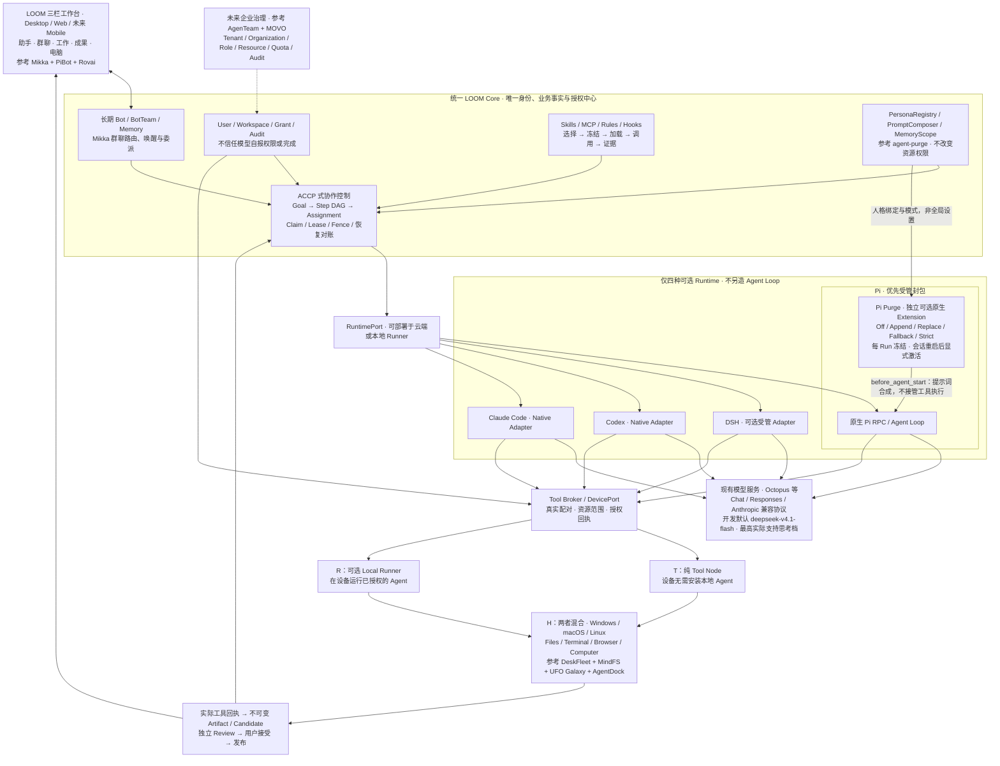

# LOOM V2 架构设计基线（P0–P14）

> **DESIGN BASELINE / 非当前进度表。** 本文保留原 27 页研究蓝图映射、已选定的 UI 与架构取舍、P0–P14 设计依据。正文出现的「最新」「当前施工」「ACTIVE_P1」「未完成」和旧时段测试数字，均按其写作时点保留为历史，不可替代现在的验收、任务授权或版本状态。
> **当前唯一事实分工**：[产品](../../PRODUCT.md) · [UI/品牌](../../DESIGN.md) · [实际 E0–E7 状态](../../LOOM-IMPLEMENTATION.md) · [Runtime/四能力/设备接口](productization-interfaces-2026-11-13.md) · [13 个固定参考项目](LOOM-V2-REFERENCE-LOCK.md) · [LOOM 导航](README.md)。
> **仍需保护**：现有用户数据与活动服务、既有 WIP 和全局 Agent 凭据。LOOM V2 施工并不自动改变 [v1.72 当前发布版本](../versions/README.md)。ACCP 是设计参考，ACP 是通信协议；四 Runtime、四能力和原已选 `loom-native` 产品界面不因整理而变更。

## A. 一页总则：用户已经确定与尚待研究的区别

**已经确定（产品边界，下一轮不得任意改变）**
1. **UI 视觉与习惯保留**：loom-native 左中右三栏、配色、助手、群聊、工作/资产/流程/电脑；后端可以替换，前端不推倒重绘。**品牌标识已由用户明确锁定为其在本轮上传的粉发、绿眼、黑色猫耳角色图片**；本机已有此图的 256px UI 工作副本（见 [K. 品牌素材与本机 Skill 调度](#k-用户品牌标识与本机-basepi-技能开发合同2026-11-16)），不得再称其为临时占位、再提议更换为机器人或擅自改成其它品牌。具体 favicon/左侧旧机器人替换尚待代码验收，不能声称已生效。
2. **允许 Core V2 大重构**：旧 Mission、AgentRun、CLI Installation、RPC、Schema 不属于必须长期兼容的产品合同；但已存用户数据、资产、密钥引用和正在运行的服务必须通过迁移/回滚保护。
3. **只支持四种用户可选 Agent Runtime：Claude Code、Codex、DSH、Pi**。四个 AdapterKind 是封闭首期产品范围；**ACP 是通信协议，不是第五种 Runtime**，**ACCP 是协作控制面参考，不是 Agent Runtime**。不再把 Cursor/其他示例强行塞进首期选择器；未来扩展机制可预留，不等于首版承诺接入。
4. **Pi 优先受管封包；DSH 可插拔且可单独封包；Pi Purge 选为 Pi 的可选 Extension**。先复用现有 Pi RPC / package-embedded-pi 资产，Pi Purge 固定 Git SHA 与许可、按 Bot/Run 显式启用，绝不另建第五内核；DSH 作为同级 Runtime Adapter 候选；按相同任务/权限/模型实测后才更改默认。Claude/Codex 保留外部/native Adapter，Windows 11 本机不实际运行 Claude Code。详见 [Pi Purge 接入合同](LOOM-V2-PI-PURGE-EXTENSION-PLAN.md)。
5. **四能力一处勾选**：Skill、MCP、Rule、Hook；Memory 为独立第五层。选择≠加载≠调用；必须有真正 Runtime Load/Invoke/Evidence 回执。Claude 旧配置可做只读扫描来源，不能成为所有 Runtime 的强制配置源。
6. **长期 Bot 与多 Agent**：Mikka 的 Bot/Coordinator/群聊路由 + ROVAI 的现有交互 + ACCP 的 Task DAG/claim/lease/Review + PiBot 每 Bot 能力与连续性。Lead 是当前群/Goal 的协调角色，不是管理员，不自动取得额外资源权限。
7. **Hybrid 设备模型**：云端 Bot 和执行地点分离。Windows/Mac/Linux 可以仅装 Device Node，提供 File/PTY/Browser/Computer；必要时选装四运行端之一作 Local Runner。Node 不得强制安装 Pi/DSH，跨设备同一 Bot 身份，单用户先交付，多用户未来扩展。
8. **参考源码锁定、权属独占、证据验收**：参考源码许可已统一为 MIT，可直接复用；用户不要求为保留旧代码过度兼容；Pi 工兵仅在正式解冻后分开工区施工，由 Root 审查真实回执，不能自称完成。
9. **跨运行端人格/记忆与授权安全实验**：从 [agent-purge](research/LOOM-V2-PERSONA-MEMORY-AND-SECURITY-LAB.md) 学通用 Persona/Prompt 管理，从 [pi-purge 0.3.0](LOOM-V2-PI-PURGE-EXTENSION-PLAN.md) 学 Pi 原生 Extension 的 Off/Append/Replace/Fallback/Strict；Pi Purge 仅属 Pi 侧插件，不属于新 Runtime 或新增第五种 Skill/MCP/Rule/Hook。PersonaRegistry/PromptComposer/MemoryScope/SecurityLab 由 Core 拥有，按 Run 固定配置并记录真正生效的证据；普通工作默认不启用 Purge，Strict 仅建议隔离实验。人格不扩大 Core Grant、也不能突破模型 Provider 政策或物理 context window。**agent-purge 的 DSH 自动审批/清空沙箱上下文代码不能原样入生产**。

**仍需冻结（设计决策，不得由工兵自行拍板）**
- 领域模型存储选型和旧数据迁移步骤；BotTeam/Assignment/RunAttempt/DeviceInvocation 的精确实体关系；
- 受管 Pi 包和 DSH Host 的平台版本、manifest/进程隔离与配置宿主；**Pi Purge v0.3.0 的可选 Extension Bundle/启动激活桥接、四模式加 Fallback、Prompt 生效回执/版本锁**；四能力继承、冲突与硬拒绝规则；
- Persona Markdown 导入/版本/作用域、Prompt 实际角色/摘要回执、跨内核 Bot/Project/Run/实验室 Memory 隔离与压缩、独立 SecurityLab 的工具/网络/凭据上限；
- Core/Node 的 Grant、credentialRef 与真实 OS enforcement；Cloud Web/WSS 身份；macOS GUI 与企业管理启用顺序；
- 三小时验收允许的是小范围真实演示还是产品级稳定发布，禁止混用标签。

## B. 唯一架构图与职责

> **用户确认的最终目标架构（含 Pi Purge）**。图表示组件归属和目标数据流，不把尚未验收的多设备、四端能力或企业隔离标为已交付；实际进度只看 [LOOM-IMPLEMENTATION.md](../../LOOM-IMPLEMENTATION.md)。

**Pi Purge 纳入 4–6 周个人可用版范围，而不是待遗忘的研究附件。** 原版 Pi 引擎保留；扩展默认 Off，普通任务优先受控 Append；高级模式必须明确作用范围，Strict 仅限隔离实验。加载、激活、原生 Prompt 合成、真实上游响应、Core 成果及用户验收分别记录，不能把 `/purge on` 当成完整 E4。四 Runtime 与三个已配置协议入口不是同一计数；每端按实际协议、模型和思考档核验。

- **Bot ≠ AgentRun ≠ Device**：Bot 永久；Assignment 指派职责；RunAttempt 是一次推理/执行；DeviceInvocation 是可独立存在、无需 CLI 的受控工具调用。没有真正的 Grant/设备配对不允许模型“自报授权”。
- **群聊 ≠ 调度数据库**：聊天是用户输入/表达，真正分工生成 Goal、Step DAG 和 Assignment，带 ContextSnapshot、ClaimLease、独立 Review。Run 结束不自动把任务标为用户已接受。
- **长期协调 ≠ 无限长进程**：Core 事务记录事件与 Outbox 后再唤醒 Coordinator；断线与崩溃使用幂等、Fencing Epoch 与 Reconciliation，不把未知副作用自动重放。
- **Runtime ≠ Device**：本地机器无 Claude/Codex/DSH/Pi 仍能被云端 Runtime 使用工具。Mac TCC、Windows 桌面会话、Wayland 等能力必须真实探测与降级。
- **四能力的生命周期**：Discover → Inspect → Select → Configure → Freeze → Materialize → Loaded → Invoked → Evidenced；unsupported/failed/revoked 也是正常可解释状态。Hook/Extension 不能越过 Core Grant。
- **用户可接受的权限**：用户策略、资源范围、Runtime 约束、OS/Container 强制执行四层独立。Human Takeover 的 Controller Epoch 改变后旧 Bot 输入一律拒绝。

## C. 四个运行端及封包边界（首期只四种）

| 产品 Runtime | 首期集成 | 封包策略 | Skills/MCP/Rules/Hooks | 受控执行位置 |
|---|---|---|---|---|
| Pi | 第一优先，受管 JSONL RPC + Agent settled | 固定版本 Node+Pi+launcher+校验清单；复用已有包构建和独立配置根 | Agent Skills、原生 MCP、Rules 注入、Extension/Hooks 映射；逐项证实 | Cloud/Local 可用 |
| DSH | 第二优先，独立 SDK/ACP/Profile Adapter | 固定 Host+Cordis Profile/Bundle，可选装并隔离 | Skills/MCP/Rules/Hook 由 Profile+Materializer 真加载；不同事件须声明 supported/adapted | Cloud/Local 可用 |
| Codex | 保留原生 Agent Adapter | 默认不封包第三方二进制，探测外部已安装/已授权实例 | 支持矩阵必须按原生接口逐项测，不继承 Pi/DSH“成功” | 选择可用的 Local/Cloud Runner |
| Claude Code | 保留配置发现/接口但本机执行禁用 | 不封包、不开启 Win11 真实调用；后续按用户安全指令另测 | 四能力状态独立；不能用 Claude 全局配置冒充本 Runtime 已启用 | 当前 Win11：DISCOVERY_ONLY / EXECUTION_DISABLED |

**重要边界**：ACP 是适配器所用线协议，不生成第五运行端选项；AgentDock 和 MindFS 是设备/工具参考而非第五 Runtime；用户提到未来扩展只意味着 Port 设计能容纳新的 Adapter，并未扩大当前产品四选项。

## D. 通用接口冻结清单（只有冻结后才可指挥写代码）

已形成讨论草案的 Ports：
- Bot / BotTeam / ChatRouter / Goal / Assignment / Coordinator
- Runtime / Device / CapabilityRegistry / Memory / Policy
- PersonaRegistry / PromptComposer / SecurityLab / MemoryScopePolicy
- Artifact / Identity / ExtensionHost

**Persona 扩展合同**： [专门设计](research/LOOM-V2-PERSONA-MEMORY-AND-SECURITY-LAB.md) + [6 对象 Schema 草案](loom-v2-persona-memory-contract.schema.json)。人格 Prompt 合成属于 Core 受管行为，不伪装成第五 Runtime、第五个四能力开关，也不能在生产设备权限链里加载未审核的 DSH purge Hook。

**下一轮 P1 冻结必须交付**：一份不可歧义的状态图（Step/RunAttempt/Invocation/Review）、每个跨层请求的 ID 及 idempotency/trace/auth 绑定、版本和权限约束、各 Runtime feature matrix（包括 unsupported），至少四种能力 Manifest/Binding/EffectiveSnapshot/真实 Receipt 的结构、协议升级策略；机器 Schema 需扩展至正式 IDL/负例，不能把当前五对象草案当全部 Contract 已定案。

版本消息必须带 apiVersion（提案 loom.v2alpha1）、请求/回执关联、上下文 snapshot digest、授权引用（不是明文密钥），并定义 accepted/completed/failed/cancelled/unknown_outcome 以及非重试的有副作用操作。

首期 UI 仅改原页面的数据服务 Adapter：不做新设计语言、不把 Runtime 特有字段写入 UI 组件。

## E. 原 PDF P0–P14 逐阶段施工顺序（保留原编号，不以旧 8 步覆盖）

| PDF 阶段 | Owner（以后才派） | 必须交付 / 不变量 | 对应实测或状态 |
|---|---|---|---|
| **P0 Reference Lock** | Research | Mikka/ROVAI/ACCP/PiBot/Pi/DSH/DeskFleet/UFO/MindFS/AgenTeam/MOVO + agent-purge + **pi-purge** 固定 SHA/license/源码定位；不依赖浮动 main | 本地 **13 个**参考 Git HEAD 已固定；Pi Purge v0.3.0 源码核实、真实组合运行未验收 |
| **P1 Contract Freeze** | Root Architect | Bot/Team/Goal/Step/Assignment/Run/Device/Grant/Attention/Evidence/Capability + Persona/Prompt/MemoryScope/SecurityLab 词典与 Schema、迁移；具体 Owner | **待冻结**（当前 V2 是讨论提案；Persona 六对象 Schema 仅供评审） |
| **P2 Domain Additive** | Domain | 新 Core V2 对象与迁移、旧用户数据可读/回滚，旧 API 可废弃不毁数据 | 未实施 |
| **P3 RuntimePort v2** | Pi/DSH/Native 适配各 owner | 四 Runtime Adapter；受管 Pi + **可选 Pi Purge Extension/Bridge**，DSH 可选；cancel/resume/approval/settled 和每 Run PromptReceipt；先验真实 session_start 激活 | 旧 Pi Bundle/launcher 已有基础，V2 Pi Purge 尚未封装/执行 |
| **P4 Runtime Bake-off** | QA | 同一 DeepSeek V4.1 Flash/max、同工具/权限跑 PDF 的 130 条，记录插件生效和内存/恢复 | 未运行 |
| **P5 Device Protocol** | Protocol | pairing、heartbeat、capabilities、Grant、Invocation/Receipt、revoke/idempotency | E3 FilePort 已有真实独立双进程证明；新 DeviceGrant 只是候选，未接 V2 |
| **P6 Windows Device Node** | Windows | Files/PTY/Git/Browser/Computer、无本地 CLI 最小设备能力、真实回执 | 初步 E3 文件 read PASS；PTY/GUI/E4/E5 未通过 |
| **P7 macOS/Linux** | Platform | TCC、X11/Wayland、PTY/Files、权限退化 | 未验 |
| **P8 Coordinator** | Orchestration | durable event+outbox、wake、Task DAG/ACCP claim/lease/reconcile、Attention/Review；人格/MemorySnapshot 在新 Attempt 冻结、旧记忆引用可追溯 | V2 未实施；**多 Agent 不是事后插件** |
| **P9 Capability Registry** | Capability + Persona/Memory | Skill/MCP/Rule/Hook/Memory Registry 与**独立** PersonaRegistry/PromptComposer；Pi Purge 的 Extension 选中/加载/激活/PromptApplied 有自己的回执，不能冒充四能力的 Invoked | V2 尚未实施；UI 勾选/人格开启/记忆召回/工具调用严格分别证实 |
| **P10 Multi-device Goal** | Integration | 同一 Bot Goal 的 Cloud Runtime/纯 Device/Local Runner 混合任务并回收成果 | 未验 |
| **P11 Computer Control** | Device + Security | 截屏/人工控制/AI 控制、ControllerEpoch、防迟到输入、RDP/UAC/TCC | 部分本机组件历史存在，不等于跨设备通过 |
| **P12 UI Preservation** | UI QA | 保留配色与布局；Hero/Presence、小幅工作区改善；原助手编辑页增加折叠「人格与记忆 / 实验室」而非重画 UI | 旧 UI WIP 保护、先做回归，原图三缺失；人格控件未实现 |
| **P13 Cloud Single User** | Platform | Linux Core、Web 登录、设备配对、跨客户端同 Bot/Goal/Memory/Artifact | Bero 空间恢复、Docker Rust smoke PASS；未部署云端 LOOM |
| **P14 Multi-user Foundations** | Security | owner/workspace/tenant 隔离、共享 BotTeam/配额、跨 tenant 攻防 | 后期实施，不提前制造企业大平台 |

**依赖调整，但不修改编号**：P0/P1 先冻结架构与接口，随后 P2/P3/P5/P8/P9 可以由独立 owner 在已冻结的合同下部分并行；P4 在 P3 真两端运行后，P10 在 P5/P6/P8 可用后，P13 在 Cloud/E5/E6 可验后。P14 数据模型从 P1 预留 owner/tenant 边界，企业 UI 后置。不要再按旧“先 W12 两文件接入旧 AgentRun → 再考虑 Coordinator”作为 V2 唯一路线。

## F. 完整验收真值

沿用 PDF E0–E7：E0 设计、E1 代码、E2 单测、E3 集成、E4 真 Runtime、E5 真跨设备、E6 故障恢复、E7 生产观测。关键不变式：**测试脚本存在 ≠ 测试跑过，运行端回应 ≠ Artifact 已验收，截图 ≠ 长任务恢复**。

PDF T0–T18 原验收全部保留；增加多 Agent 定向 T19–T22：
- **T19 Team Routing**：@ 某 Bot 与无 @ 时能解释选择；只被选中者回复/派工，其他成员不重复消耗。
- **T20 Assignment DAG**：一个 Goal 两个独立 Worker、冻结上下文、依赖与 Lease；其中一个崩溃/超时后，另一个不被错误接管。
- **T21 Context & Late Reply**：旧 Worker 过期 Lease、旧配置/Grant、错误 tenant 的结果不能影响现行 Goal/Artifact。
- **T22 Capability Cross-Runtime**：相同四能力选择分别由 Pi、DSH、Codex、Claude adapter 显示 native/adapted/unsupported（Win Claude 实测不启用），有正负例 Load/Invoke 证据。
- **T23 Persona Import**：第三方 Markdown 人格导入→来源/license/SHA→Bot Binding→Pi 实际 Prompt Load；切 DSH 不改变 BotId。
- **T24 Prompt Modes**：Off/Append/受控 Replace 的真实 role/hash 和应用状态可审计；若宿主只支持静态启动则需新 RunAttempt，不报热切通过。
- **T25 Memory Isolation**：Bot/Project/Team/Run/Lab 记忆共享遵从 owner/scope；隔离安全测试数据不能写入普通 Bot 长期记忆。
- **T26 Guard Persistence**：模拟恶意 DSH/Plugin 自动放行、Prompt Injection 与更换人格；Core/Device 的审批、Grant、沙箱拒绝仍生效。
- **T27 SecurityLab Cleanup**：使用假凭据/模拟工具/隔离网络、到期撤销与清理；生产服务和浏览器 Cookie 不受影响。
- **T28 Context Recovery**：Token 预算/摘要/检索/Checkpoint 恢复真实 Goal 与来源引用，不宣称突破 Provider 物理上下文限制。
- **T29 Pi Purge Off**：未选中/重启后关闭时，受管 Pi 原生 Prompt/工具/上下文无意外改变。
- **T30 Pi Purge Activation**：原 UI 选择 Pi Purge 与 Persona 后，下一 RunAttempt 通过受管启动通道真实启用并产生 PromptReceipt；仅环境变量/文件存在不算通过。
- **T31 Pi Purge Modes**：Append、Replace、Fallback、Strict、Off 的实际 Prompt hash/锚点降级/丢失 Skills/Rules 指引各有正负例与明确告警。
- **T32 Multi-Bot Isolation**：两个 Bot 并行不同 Pi Session/Persona，崩溃重启从 Core Binding 恢复且不串人格/记忆。
- **T33 Lab & Grant Fence**：Strict 的隔离实验、审批/工具 Grant 负例仍 fail-closed，Plugin Hook 次序不能绕过 Core/Device 边界。

未来真实可用定义（不是本轮已完成）：用户在原 UI 创建 Bot、拉另一个 Bot 入群、给 Goal、自动派两个受控工兵、受控 Device-only Win 完成工具操作、通过 Review 得到能打开的 Artifact；任务/设备中途断开后恢复，不破坏已有用户数据。完整 macOS GUI 和企业隔离另设后续 Gate。

## G. 已知资产与保护/迁移规则

- 当前仓库仍是 Rovai v1.72（docs/versions/README.md）；**本轮不是切换 current_version**。
- 现存五处历史未提交 WIP：Inspector.tsx、product.css、crates/loom-node/src/lib.rs/process_wire.rs/session.rs，全部保留；既有 64851 不重启。
- E3 的真实证据仍在 _artifacts/loom-execution-20261115/pure-device-runs/.../e3-proof.json；Node 新构建/Protocol 33/33 属旧小切片。Bot→Artifact E4、Linux→另一物理 Win E5、E6 未签收。旧 3/8 AgentDock 板**仅代表当时局部任务**，不得重标为本总计划 P0–P14 完成率。
- 参考项目只读位于 _artifacts/reference-repos/ 和 ../_references/，不能被工兵直接替换到产品或自动升级 Git HEAD；许可证/安全与二进制散列需单独审查。现有项目功能可以选择性复用，但**旧接口保留并非产品要求**。
- 正式替换须先做数据导出/影子读取/迁移 dry-run/feature flag/回滚演练，不允许在当前日常用户数据上直接演练。
- DE-BERO 可用余量曾在批准清理两处旧 Rust target 后恢复约 23.4 GiB；不是今天部署资源/长期存储额度的承诺，实际施工前重新测 df 和运行容器。GitHub push/build image **仅是后续批准实施阶段的可选交付通道**，不在本轮操作。

## H. 实施方式、权限与三小时现实目标

下一轮只有在 Root 将 P1 合同和 Worker Write Allowlist 冻结后才能实际启动工兵。每个 Worker 的卡必须有 TASK-ID、Owner、阶段、依赖、参考 SHA、可写文件/目录、测试和必需回执、失败条件、回滚、终态交接。Root 指挥/审查/合并，Worker 不自行改变产品架构、不向其他 Worker 扩权，不并发写同一文件，QA 独立。

**3 小时是冲刺时间盒，不是“4–6 周产品已完成”的替代证据**。Pi Purge 是 [可选受管 Extension](LOOM-V2-PI-PURGE-EXTENSION-PLAN.md) 而非第五 Runtime；Persona/Memory/SecurityLab 与 Pi Purge 已列进 P0/P1/P3/P4/P8/P9/P12 和 T23–T33。三小时仅争取 Pi Purge Off/Append 的一条可信端到端记录，不能用打包成功冒充激活成功；三小时优先建立可测 Persona Binding/PromptSnapshot 的窄切片，不以赶工为理由接入能自动放行工具审批的 DSH 插件，完整长记忆/跨 Runtime 人格 A/B/隔离安全测试按后续 Gate。目标为尽量形成一个可核验的最小功能链，同时记录真实未完成；按 [3 小时实战计划](archive/legacy-plans-2026-11-15/LOOM-V2-3H-FAST-TRACK.md) 严格切片。4–6 周单用户基础版的估计不会因为工兵并行而自动归零；跨机、断电恢复、四端插件兼容、企业隔离依旧需要实际验证。

## I. 当前讨论交接

**最新开工交接（2026-11-15）**：用户已授权本轮执行，四路 Pi Skill 由 Root 从总管目录 `skill-cli` 派工，首批文件/身份/模型/验收冻结于 [P1-A 合同](LOOM-V2-P1-FOUR-LANE-SLICE-2026-11-15.md)；即便已有后台运行记录，也仅表示工兵启动，不等于新 V2 真测试 E4/E5/E6 已通过。Root 按工兵回执逐步验收、记录未通过，不复活旧 W12 补丁或拿历史 3/8 代替总计划。既有 WIP、历史决策、参考镜像、用户数据和原服务保持原样。

## J. GitHub/Bero 优先的施工及验收路线（2026-11-16）

> **执行决策，优先于旧的“每轮本机编译”习惯；不是发布授权。** 优先减少开发等待、重复构建和污染用户电脑，按固定源码 SHA 获得可复现回执；不以工兵数、测试数量或 CI 绿灯代替产品交付。完整 E4–E7 与原定 4–6 周**单用户可用版**验收标准不变。最新实证在 [本机续建交接](archive/legacy-plans-2026-11-15/LOOM-V2-CONTINUATION-2026-11-15.md)。

### J1. 三处环境的唯一职责

| 位置 | 默认承担 | 不承担/门槛 |
|---|---|---|
| **GitHub Actions（首选可复现 CI）** | feature/PR 的 Windows 2022 Host+Web 清洁构建、固定受管 Pi 0.85.1、真实 Electron 自动化、正式 Host Bearer v5→双 Pi Artifact→Mikka UI Review 的单次**隔离 E3**；Linux TypeScript/Rust 合同检查；非发布 artifact、TAP/manifest/SHA 与缓存 | 不自动部署、合并 main、覆盖 v1.72 或冒充 E4；`.github/workflows/windows-package.yml` 当前只支持 main 手动发布包，**不能**将它冒充已具备 V2 PR E3 验收。为 V2 新增独立 workflow/job，限制权限与事件 |
| **Bero（隔离 Linux 构建/运行）** | Rust Core/Linux Host 重量级编译、Linux 回归、受控云端单用户/Device 协议联调、后续 E5/E6 的服务器一侧；独立目录或容器、绑定固定 commit SHA 与受控 Cargo target 缓存 | Linux 不能证明 Windows DACL、NSIS 或本机 Electron/物理设备；先核 `df`、内存、旧服务/容器隔离和最小源码传输许可。过去有磁盘接近耗尽及上传被拒记录，**未重新准入不得上传** |
| **用户 Windows（减负）** | Pi 工兵开发/短增量检查、Windows 原生权限和 Device-only 节点、本机 1440/390px Mikka 真实可用性、用户最终接受/拒绝/返工、E5 物理设备另一端 | 不默认循环全仓 Cargo、清理 `target`、重建安装包；不得碰日常数据库、64851、全局 Runtime 凭据或五处 WIP；需要本机原生验证时用受保护**一次性** Core、独立 Electron profile |

### J2. 下三单，按依赖落地，不等待全部功能开发完

1. **CI-A：建立 V2-only Windows E3 PR/手动任务**。Root 先隔离未提交代码，审出严格文件白名单，创建与 v1.72/main 独立的 V2 分支/PR，不做 `git add -A`。用固定 Node/pnpm/Rust/受管 Pi、隔离 Windows Runner 和 `pnpm build:web`、`cargo build -p rovai-host --locked --bin rovai-host`，运行 `scripts/lib/loom-v2-official-host-electron-review.test.mjs`；测试需为**1/1 PASS、0 skip**，上传打码后的原始日志、测试断言、Host/Pi SHA、commit、OS、artifact receipt，明确 `mockProvider:true`、`humanClickedUI:false` 和 E4–E7 `NOT_RUN`。验证 Runner 工具链（现有打包 YAML 用 MSVC，本机之前使用私有 MinGW），不得假设跨工具链自动成功。CI 是候选构建，不产生 Release/生产安装。
2. **CI-B：Bero 隔离 Linux 重型回归**。确认 SSH/仓库传输授权、磁盘/内存/容量上限、当前正在跑的服务后，从**已审核的固定 Git SHA** 拉取或按允许通道传输；独立 Cargo target/cache、限编译并发，不扫或覆盖服务卷。跑 `cargo fmt --all -- --check`、限定 `rovai-core --lib loom`/适用的 Linux Host 集成、`pnpm typecheck`，把成功/旧环境基线失败分别记录；远端缺权限、空间不足或与生产环境冲突就停在 BLOCKED，并转 GitHub Linux Runner，不通过另一条路径绕过拒绝。
3. **CI-C：将 E4→E5→E6→E7 的证据按环境分配**。E4 首先完成真正的 Core→Model/Tools 及四 Runtime×Skill/MCP/Rule/Hook 的选中、加载、实际调用或显式 unsupported receipt；E5 在 Bero + **另一台真实物理设备**，E6 真断线/重启/旧 Lease 拒绝，E7 安装/升级/迁移 dry-run/回滚和 Owner 亲自验收。CI/假 Provider 不能签收真人、实体设备或商用模型。

### J3. 总管/工兵提效规则（从下一轮立即生效）

- Root 每轮从**一条实际关键路径阻塞**拆为最多 **2–3 个互斥短工单**；先用 Base Skill 路由，再通过 Pi Skill 托管运行。每条有任务 ID、唯一写白名单、依赖与明确停工条件；未冻结接口时只读 Scout，不让数十个工兵并发改同一 Core/UI。上一批4路实测只有2路交付、2路420秒超时，不能拿“派了4个”冒充4倍速度。
- 工兵交付的是可检查的代码 diff/单个测试/失败定位，不是无边界长时间研究；优先 **2–4 分钟有界任务**，一旦超时或无增量就收窄任务、切模型/工具，不持续重复相同提示。Root 独立审阅合并、跑聚焦检查、亲自监督 Mikka 信息层级、键盘焦点、390/1440px、未知回执和 Review 误触；视觉不推倒重做。
- **本机快速反馈→CI 清洁门禁→下个增量**：日常仅改动相关类型/单测/短 Host 编译；只有接口/安全/版本变化才触发对应 E3/E4 清洁构建。相同 commit+相同环境的绿灯用 SHA 复用，不重跑只为凑测试数；CI 红灯只重跑失败范围并保留原始报错。受控 cache 设上限，不随意 `cargo clean`。
- 每个完成/失败在唯一 [LOOM 当前实施与验收](../../LOOM-IMPLEMENTATION.md) 更新并链接原始证据，记录**commit/源文件 SHA、Runner/Bero/Win 位置、命令、退出码、原始证据位置、模型真伪、E门禁、下一阻塞**。只有签过的阶段才能宣称完成；`ACTIVE`、Pi 会话数、CI job 创建或启动不等于连续后台开发。日常普通错误由 Root 自行处理，不因一组测试通过中断找用户。

### J4. 外传/发布安全边界

- 本段授权的是**施工方案与资源优先级**，不表示本次已经 push 或授权绕过此前自动拒绝的源码外传。未来准备 GitHub/Bero 操作时先确认仓库归属、分支保护、必要凭据与合法传输范围；只推已审的 V2 分支，绝不推主仓库脏工作区或现有用户凭据；CI 用只读 token、最小权限，PR 不执行不可信代码附带秘密；传输前检查忽略文件和 secret scan。
- PR 构建、GHCR 私有测试镜像、Bero 隔离目录、production/main Release/用户数据迁移是**不同 Gate**。不能把 CI pass 自动升级为部署授权、不能借云端绕过本机禁止项。E4 模型费用与 GitHub Actions 额度按可观察预算控制，必要时用手动触发/并发取消；不凭空估算节省百分比或工期缩短。

## K. 用户品牌标识与本机 Base/Pi 技能开发合同（2026-11-16）

**用户明确决策，已冻结，非建议或待讨论：**本轮用户上传的下方粉发绿眼、黑色猫耳与蝴蝶结的角色形象**就是 LOOM 品牌 Logo**，不得贬为临时占位、替换为另外绘制的机器人、擅自换风格或再次征求是否喜欢此品牌。整体 Mikka/LOOM UI 的左中右三栏、配色与交互继续保留，不因换标识而重做。

- **上传原件证据**：本会话用户上传 `DA3A8DC1-579B-44C7-8C1B-A9082072277A.png`（1254 × 1254，RGBA，1,797,701 字节，SHA256 `eff1aa63e7bdb3ebc5b1a58c3048bfa051553078a159f337c45cbe67f8a71d04`）。本机现已存可直接用于小图标和侧栏的**同图缩放、WebP 压缩工作副本** `docs/loom/assets/loom-brand-user-approved-256.webp`（256 × 256，5,026 字节，SHA256 `9bd461c1f5a44ebb0452297de50f5d713026bc7c417a7eba7ec0d67f14558d7a`）；**不是原件逐字节拷贝**，不可把这个缩略版的 SHA 称作上传 PNG 的 SHA。原图应作为日后高清源，缩略图作为 UI 资源基线。禁止工兵再用自动生成的替代形象。
- **必须实施的视觉范围**：Web 标签页 `apps/web/index.html` 引用的 `apps/web/public/loom-favicon.svg`、Desktop renderer 标签页 `apps/desktop/src/renderer/index.html` 引用的 `apps/desktop/src/renderer/public/loom-favicon.svg`，以及左侧品牌机器人 `apps/desktop/src/renderer/src/loom-native/Avatar.tsx` 的 `LoomMark`（同组件也出现在 Web 登录页）。三者一律改为**上述同一张用户批准图片**；涉及默认品牌/无头像 fallback 时同源对齐，但**不得覆盖用户自定义 MemberAvatar/avatarRef**。保留原布局、点击/键盘区域、亮暗模式和可访问名称；16/32px 识别、1440/390 宽度、浏览器 favicon 缓存/新标签与 Desktop UI 要由 Root 实测。当前本条只完成**决策锁定、素材本地落地及定位**，**代码替换尚未完成**，别把记录冒充发布。
- **开发工具优先级（适用于后续 LOOM V2 工程轮次）**：① AgentDock `agentdock_context` + `workspace_context`、独占 Root 租约、`task_create/manage`；② 在 `C:/Users/echo/.claude/skills/base/SKILL.md` 指导下先用 `python C:/Users/echo/.claude/tools/base_skill_cli.py route "任务描述"` 路由到实际技能，不自行重做已有浏览器/桌面/搜索/远端工具；③ 具体匹配时优先使用现成 `agent-browser-cli`（真实 Chrome）、`computer-control`（Windows GUI）、`ast-grep` / `fast-context`（需要的代码检索）、`berobox`（Bero 任务，先核权限）；④ 客观可验的只读定位/单文件编码任务交给 `pi-skill`，并由 Root 审核。**Base 是路由管理层，不是替代所有 Skill 的执行器**；不要为了“调用更多工具”而增加无谓开销。
- **Pi Skill 有界工单合同**：按 `C:/Users/echo/.claude/skills/pi-skill/SKILL.md`，只读 Scout/Reviewer 用 `--tools file`，需写的 Worker 首轮只报微计划，Root 审过后在**唯一文件白名单**上实施；优先两至三条互不冲突的 2–4 分钟短任务。AgentDock 宿主用受管 `exec_command(execution_mode=async)` 执行 `pi_skill_cli.py run`，**不能用`start`伪后台**（Windows Job 回收）。结束核对证据、独立最小复测，再 `approve accepted|returned|rejected`，把成果写回交接。工兵不得碰用户凭据、现用 64851、日常 DB、原五 WIP、全局 Pi/DSH/Claude/Codex 配置、GitHub/Bero 外传或自启另一个总管。
- **当前施工真实状态**：Base 已读取且路由执行，Pi `scout` 仅只读核实 Web/Desktop 双 favicon、`LoomMark` 三入口；截图/品牌素材已存本机。后续品牌代码修改和真机 UI 验收仍 OPEN；E4–E7 以及 4–6 周单用户可用版仍遵循原分阶段门禁。
