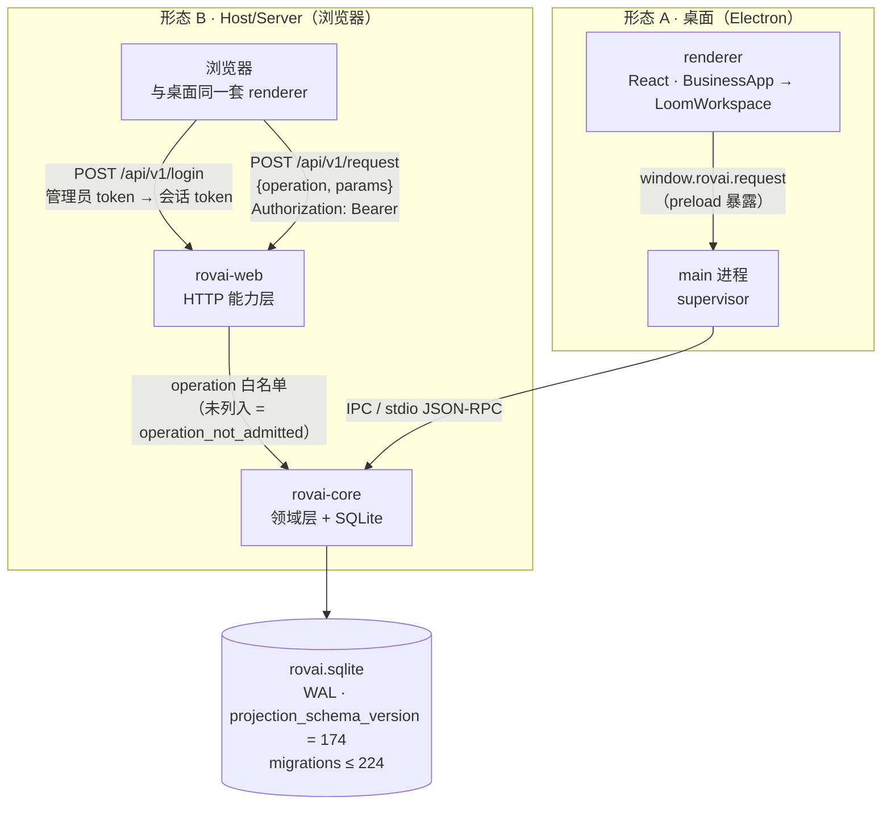
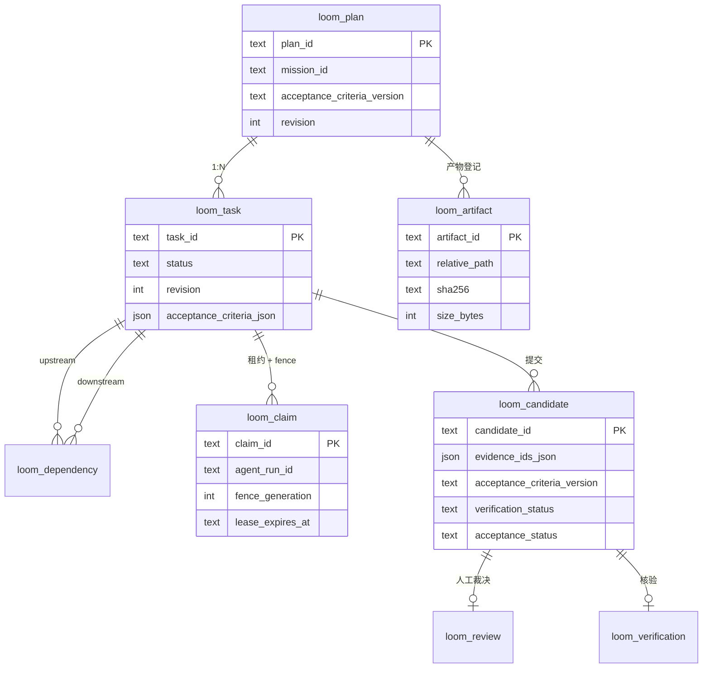

# LOOM 架构与实现现状（2026-10-29，对应 `main` = `6c3c355`）

本文只写**代码里能读到、跑过能验证**的东西。凡是没证据的，标「未验」，不写成结论。

---

## 1. 进程与传输



- **代码复用是真的**：`apps/web/src/main.tsx` 直接 import 桌面渲染层的 `BusinessApp`，两边只有「客户端」不同——桌面走 Electron IPC，浏览器走 `ConsoleClient`（HTTP）。
- **能力面是手写白名单**：`crates/rovai-web/src/operations.rs` 的 `Operation` 枚举逐条列准入，**不是**把 Core 的 RPC 全量映射到网络。默认拒绝。
- 二进制：`rovai`（stdio 形态的 Core）、`rovai-core`（测试与探针用的 Core）、`rovai-host`（带 supervisor 的宿主，可 `--web-listen` 起 HTTP）、`rovai-server`（无头服务端打包入口）。
- 监听非回环地址时必须显式 `--allow-insecure-lan`，否则宿主拒绝启动——这条是硬门禁，不是文档建议。

## 2. LOOM 数据模型（本产品分支新增）



**三条不变量**（都由数据库触发器或代码强制，不是约定）：

1. **已记录的产物/候选/裁决/核验不可改**。`loom_artifact` 三层触发器（禁止 UPDATE、禁止替换同名行、禁止绕过 plan 直删）；候选/裁决/核验同理。换掉的证据是**新产物 → 新候选（带 `previousCandidateId`）**，永远不是编辑。
2. **两条独立轴**：`verification_status`（unverified / passed / failed）与 `acceptance_status`（pending / accepted / rejected）互不推导。核验通过不等于验收通过。
3. **一个 Mission 只有一份计划**：第二次 `loom.plan.import` 撞 `LOOM_PLAN_EXISTS`；此后 `acceptance_criteria_json` 无任何产品路径改写。

## 3. 实现现状：RPC 与准入

15 个 LOOM RPC，其中 **10 个对 web 准入**（本轮新加，提交 `168b606`）：

| RPC | 读/写 | web 准入 | 说明 |
|---|---|---|---|
| `loom.plan.get` | 读 | ✅ | 计划与标准快照 |
| `loom.tasks.list` | 读 | ✅ | 任务 + 阻塞原因 |
| `loom.dependencies.list` | 读 | ✅ | 依赖求值（冻结溯源） |
| `loom.claims.list` | 读 | ✅ | 租约 / fence / 过期 |
| `loom.candidates.list` | 读 | ✅ | 候选 + 两条轴状态 |
| `loom.reviews.list` | 读 | ✅ | 人工裁决 |
| `loom.verifications.list` | 读 | ✅ | 核验结论 |
| `loom.artifacts.list` | 读 | ✅ | 已登记产物（本轮新增） |
| `loom.review.record` | 写 | ✅ | Owner 的裁决 |
| `loom.verification.record` | 写 | ✅ | 核验结论 |
| `loom.plan.import` | 写 | ❌ | agent 侧：导入计划 |
| `loom.task.release` | 写 | ❌ | agent 侧：放行任务 |
| `loom.claim.acquire` | 写 | ❌ | agent 侧：认领（租约 + fence） |
| `loom.candidate.record` | 写 | ❌ | agent 侧：提交候选 |
| `loom.artifact.register` | 写 | ❌ | agent 侧：登记证据（Host 从磁盘字节算 hash） |

设计意图：**浏览器里的 Owner 只能看与裁决，不能让工作发生**。副作用要说清楚——纯 web 用户无法自己造出一份计划，必须由桌面端/agent 侧导入。

## 4. UI 结构

```
Sidebar → Missions（看板：Needs you / Not started / In progress / Complete）
        → Mission 卡 → 右侧 Mission 文档
                        └─ MissionActivityDocument
                             └─ LoomWorkspace  ← 三个 tab 共用同一组件
                                  ├─ 活动：目录、工作区变更、队员交付
                                  ├─ 编排：依赖统计 + 泳道图（任务卡显示认领、fence、阻塞原因）
                                  └─ 交付：候选卡（两条轴徽章 + 逐条证据：路径 · 短 hash · 大小 · 登记态）
```

## 5. 证据等级（这是回答「能不能上线」的依据）

| 类别 | 有证据 | 等级 |
|---|---|---|
| LOOM 领域逻辑 | bero Linux：全量 `--lib` 507 passed / 3 failed（基线）/ 1 ignored；`--lib loom` 75/0；准入矩阵 1/0 | 强（单平台） |
| 真 Core 全链路 | `pnpm test:loom-core` 2/0：真二进制、真 SQLite、stdio JSON-RPC | 强（无 Runtime） |
| UI | Electron 夹具 22 例 1/0、20 张截图、errors 空；三档宽度断言 | 强（Chromium） |
| 契约/类型 | `pnpm typecheck` 0 错；`vitest packages/contracts` 15/15 | 强 |
| 真产品实例 | `rovai-host` + 真 SQLite，浏览器里亲手点过三个 tab | 中（单机、单库） |
| GitHub Actions | Linux 全量 gate 绿（最近 `6c3c355`） | 强（单平台） |

## 6. 「能上线吗」——不能，缺的是这些

按缺口性质排序，每条都给了「为什么缺」而不是「以后再说」：

| # | 缺口 | 为什么它是 blocker |
|---|---|---|
| 1 | **平台覆盖**：产品是 macOS / Windows 桌面；我全部证据来自 Linux + CI | 打包、签名、公证、安装器升级、Windows 侧文件路径行为都没跑过 |
| 2 | **真 Runtime 从未接入**：LOOM 的 e2e 明确不启动 agent Runtime | 「agent 认领 → 交付 → Owner 验收」这条链只被我自己灌的假 agentRunId 走过 |
| 3 | **数据库二次打开**：bero 上同一个 Core 库第二次打开必 `IdentityChanged{Revalidation}` | 该现象被记成环境基线、但**从未被解释**。未解释清楚前，Linux 服务端形态属于猜测 |
| 4 | **升级路径**：当前 `projection_schema_version = 174`、迁移到 224 | 没有「从上一个发行版数据库升级」的测试；迁移链 224 步、新增一列要动约 10 处 |
| 5 | **物理 iOS/Safari** | 引擎、文本自适应、安全区全未验（Chromium 模拟覆盖不到） |
| 6 | **web 能力面只到 10/15** | 纯浏览器用户无法建计划；这是设计取舍，但产品文档必须写明，否则是功能缺口而非取舍 |
| 7 | **安全评审**：单 bearer token、token 打在终端 | 我做过路径逃逸与不可变校验，但没做限流/威胁建模/上传下载审计 |
| 8 | **规模**：单进程 + SQLite | 无并发/负载测试 |
| 9 | **可观测性**：LOOM 没加任何指标或诊断事件 | 线上出问题只能看数据库 |
| 10 | **LOOM UX 不完整**：无计划编辑、无改版（`LOOM_PLAN_EXISTS`）、无候选撤回 | 真实使用中「计划要改」是常态 |

**一句话**：阶段二的「完成」= **本轮验收范围（LOOM 证据/认领/裁决链 + 三个 tab + 不可变性 + 换链竞态）在 Linux 上有证据地做完了**，不等于产品可发布。发布还需要上表 1–4 先落地。
