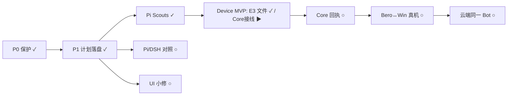

# LOOM Mikka-first 实时执行看板（Mindkit / AgentDock）

> **历史归档 / OLD_STATIC_PROGRESS / 不再作为 Core V2 施工指令。** 用户最新要求「本轮只整理架构、不开工」，后续唯一入口：[LOOM V2 总计划](../../LOOM-V2-MASTER-PLAN.md)。此文件原始正文与当时测试结论仅作历史证据；原字节 SHA256 快照在 [历史归档](README.md)。**不得依据下文旧“已授权开工/唯一入口”重新派工**。

> 可视化：直接用浏览器打开 [离线 HTML 进度看板](loom-mikka-first-progress-2026-11-15.html)。该板是**阶段性人工更新的项目进度快照**，不是实时 WebSockets。每次交接同步 `TASK.md`；实时 Pi 进度通过受管 AgentDock session/本地 Pi Skill `status` 查。运行端口、PID、临时进程状态不可当永久稳定事实。

## 2026-11-15 开工执行快照（AgentDock 实机证据）

| 阶段 | 状态 | 证明与下一动作 |
|---|---|---|
| P0 保护+Mindkit | **PASS** | 原分支/五 WIP/旧研究文档已核对；patch + SHA 在忽略的 `_artifacts/loom-execution-20261115/`，64851 可连 |
| P1 正式计划 | **PASS** | 五份正式文档已写入、读回、核对 SHA；Mindkit TASK/PROJECT_CONTEXT 顶部最新授权已更新，guard verify 通过 |
| Pi 工兵探针 | **PASS（只读研究）** | Device/Runtime/UI 三路 Pi Scout 的 durable status 都为 completed；DeepSeek V4.1 Flash 真调用；不等于产品验收 |
| Bero 沙箱入口 | **STORAGE_RECOVERED / RUST_SMOKE_PASS** | 用户批准的两处旧 Rust `target` 精确删除已完成，释放 28.0 GiB；根盘 88%、可用 23.4 GiB；Docker Rust 1.99.1 实际离线编译/运行 PASS，LOOM 仓库 `cargo metadata --locked --offline --no-deps` PASS；**完整 LOOM build 与 Cloud E5 仍 NOT_RUN** |
| W10/W11 Device 技术 MVP | **PARTIAL / BUILD+E2 PASS** | W10 Node 独立 worktree 编译 `loom-node` exit0；W11 独立协议候选 33/33 Rust 单测 exit0。旧预编译 Node 55/0/2；**新 Node 单测未完成**，超时停在重编译 |
| W12 Core Receipt/Artifact | **SAFE_BLOCKED / W12A+B+C 合同重划** | Scout `7887f6f21863470bbf2a76782baa34e5` + Worker `4c7f285307784b0c9e83e521cd6e6bb3` 均已结束。真实发现：旧 Run 冻结目标强制 CLI installation，设备 E3 FilePort 又不等于 Runtime-services archive transport；不能在两文件内伪造授权。Worker 只留 51 行安全加固未合并/未测候选。下一工单见 [DeviceInvocation 架构修订](loom-mikka-first-device-invocation-seam-2026-11-15.md) |
| W13 真跨机链 | **NOT_RUN（E3 子集已过）** | 单台 Win11 上真实 Core→独立 Device-only Node 配对/列目录/读44字节/拒绝 `..` **E3 PASS**，但 Linux A↔物理 B、AgentRun、Artifact/Review 仍未验 |
| Pi vs DSH | **PI MODEL REAL RUN / COMPARISON NOT_RUN** | Pi Skill DeepSeek V4.1 Flash/max 实际完成 3 Scout + 2 Worker 的执行；DSH 同条件 bake-off 未进行；doctor 模型目录仍提示漂移 |
| UI Hero + 品牌 | **WIP / BRAND_BLOCKED** | 旧 Hero 方向性测试，图三未落本地 |
| Cloud 单用户/多用户 | **PLANNED** | 首个 MVP 通过后优先迁移能力 |



## 真实可用里程碑：Device-only 文件工具（E3 PASS / 非 E5）

- **独立双进程真实链路**：新 Host `rovai-host.exe`（随机 `127.0.0.1` 端口、独立 DB）→ Device-only `loom-node-device-only.exe`（无 Pi/DSH/Codex/Claude CLI、独立 private node data）→ `/api/v1/nodes/workspaces/files` 实际列出/读取预置 Git 工作区 `device-proof.txt`。
- **测试为真**：真实 HTTP/WS/本地磁盘往返成功，读回 44 字节；相对路径 `../outside` 被 `path_rejected` 拒绝；Node inventory `clis=[]`、`activeRunCount=0`；退出后仅关闭夹具启动的进程。回执：`_artifacts/loom-execution-20261115/pure-device-runs/3d1ec28e1a214fc5827c11a678b4c795/pure/evidence/e3-proof.json`；测试脚本 `_artifacts/loom-execution-20261115/pure_device_fixture.py`。
- **版本证据**：隔离 Node 候选 `_artifacts/loom-execution-20261115/builds/loom-node-device-only.exe` SHA256 `B9FC8D0963B8A2130D44AF1E86ECCFF735DC089D8D484F5D90A69CAB8E8B9138`；`cargo build --offline -p loom-node --bin loom-node` exit 0，见 `node-build.log`。其已包含 Git 只读扩展候选，**对应新增 Git 用例没有通过最新单测**。
- **Pi 工兵 W11**：独立 `worktrees/proto` 的 `device_grant.rs` + `lib.rs` 候选源，`cargo test --offline -p loom-protocol --lib` **33 PASS / 0 FAIL**，见 `protocol-full-tests.log`；新模块仍标 `UNWIRED_PROPOSAL`，不能据此宣布 Core 授权上线。
- **旧 Node 单测**：旧二进制本轮实际重跑 **55 PASS / 0 FAIL / 2 ignored**（`node-prebuilt-full-baseline.log`），但它早于本轮 W10/W11 及主管 Git 扩展；新源码的 `cargo test --offline -p loom-node --lib` 在大型 Core dev 编译阶段超时，未得到本轮新二进制的单测终态。10053 历史随机竞态不能仅因旧二进制本轮 PASS 便注销。
- **其余真实缺口**：没有云 Linux 主控 A ↔ 独立物理 Win B E5；没有 AgentRun→Core DeviceRouter→Receipt→Artifact/Review 端到端；没有动态 Grant 的设备端 enforcement；没有完整 PTY/Browser/Computer；没有 logo 源图。**T2/T3/T4/T5/T7/T9 继续 NOT_RUN**。
- **已知门禁**：`pnpm docs:check` exit1，现有 v1.72 两份 model-context-change 文档缺 confirmation 元数据（`_artifacts/loom-execution-20261115/docs-check.log`）；无权把未确认文档虚改为 confirmed。Bero 已按用户逐项目授权精确删除两处旧 Rust target（28.0 GiB），`df -h /` 回到 196G、88%、可用约 24G（23.4 GiB）；Docker 离线 Rust smoke 与真实 LOOM Cargo metadata PASS，但完整构建/跨机部署仍 NOT_RUN，保留 20 个在线容器/所有数据卷。

## 当前执行任务和断点

- **主任务**：AgentDock `tsk_407c504cc8494d6d`，当前聚焦 protect→plan→Pi-scouters→Device MVP。
- **延续研究任务**：此前 `tsk_c436dfbdc2cd454f` 是方案核实；深度研究的新报告已经存在，但 Deep Research 研究会话自身不能操作本机 Windows；本次 AgentDock 是真正写文件的负责人。
- **Pi 工兵**：Device/Runtime/UI 三路只读 Scout 已完成（`a1248983965948ef838ac3c912e2a454` / `c18b96e648a64162bb33db17ffd66920` / `e9b3389e886a4c908cc0769d581e880a`）；W10 Node `408797af3b71482dafd1473c1d91b0d2` 和 W11 Protocol `f3618c224e99477282f5a965f627cf53` 两轮均已完成，候选源码写在各自 worktree；主管测试/合并决策尚未签发，**不误称持续后台施工**。
- **模型问题**：`pi-skill doctor --json` 有 DSH→Pi 模型目录漂移警告；但 `oct-chat/deepseek-v4.1-flash` 已以真实 tool events 成功执行 Scouts/Workers，未读取或输出 Key、未重写共享配置。
- **生产边界**：原 64851 继续在线；五 WIP 未合并，未启动 Claude Code。是否能推出 Cloud A + Win B 的完整真机链取决于 Node/Core 合同与 Bero 云端隔离部署。

## 工兵验收状态行模板

```text
[时间] TaskID=...
Owner=...
Git Base=... / Worktree=...
File ownership=...
Pi Session=...
Changed files=...
Checks actual exit=...
Evidence path=...
Status=PASS|FAIL|PARTIAL|NOT_RUN
Next owner=...
```

## 相关导航

- [正式工程计划](loom-mikka-first-execution-plan-2026-11-15.md)
- [工兵任务卡](loom-mikka-first-worker-orders-2026-11-15.md)
- [验收矩阵](loom-mikka-first-acceptance-2026-11-15.md)
- [用户通俗版](loom-mikka-first-plain-language-2026-11-15.md)
- [旧研究计划（历史）](../../research/architecture-discussion-master-plan-2026-11-15.md)
