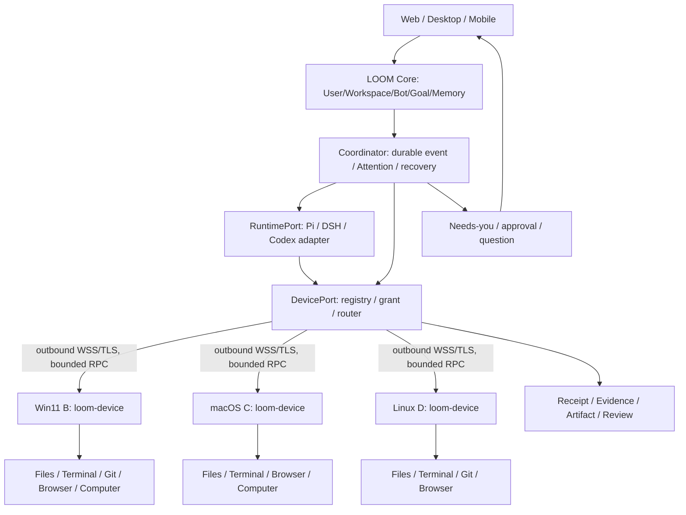

# LOOM Mikka-first / 多设备 Bot — 实施总计划 v1.0（用户已授权开工）

> **历史归档 / SUPERSEDED_PLAN / 不再作为 Core V2 施工指令。** 用户最新要求「本轮只整理架构、不开工」，后续唯一入口：[LOOM V2 总计划](../../LOOM-V2-MASTER-PLAN.md)。此文件原始正文与当时测试结论仅作历史证据；原字节 SHA256 快照在 [历史归档](README.md)。**不得依据下文旧“已授权开工/唯一入口”重新派工**。

> **2026-11-15 新授权**：用户明确要求由 AgentDock 接管本机推进、按 Mindkit 交接、使用 Pi Skill 多工兵、可大重构、优先交付可用闭环，并允许隔离 Bero/Linux/Docker/云端构建。此授权替代 2026-11-15 旧讨论稿中的“禁止实施”，**但不授权覆盖五个历史 WIP、清空数据库、破坏 64851 服务或在 Win11 运行 Claude Code**。
>
> **本计划是执行入口，不是完成证明**。现状以 [实时阶段板](loom-mikka-first-execution-board-2026-11-15.md)、[测试矩阵](loom-mikka-first-acceptance-2026-11-15.md)、Mindkit `TASK.md` 和原始回执为准。当前版本规范/合同仍需按 `docs/README.md` / `docs/versions/README.md` 的流程治理；本稿不会偷换规范真源。

## 0. 三句产品定义

- LOOM 是**长寿的 Bot**：Bot 身份、记忆、Goal、等待处理、工作成果和用户接受权属于用户/Workspace，不属于任何一台电脑或一次 Pi/DSH/Codex 进程。
- LOOM 是**可移动的操作员**：Linux 云端可协调多台 Windows/macOS/Linux 的 File/Terminal/Browser/Computer/LocalService 工具，B/C **不必**安装模型或 CLI。需要重 repo/低延迟时，用户可以加本地 Runner。
- **保留用户喜欢的 loom-native UI**；优先真实可用，不先抽象重写全部 Core，不以“零 bug”拖延首次真实 E2E。用户将来能用 Web/手机/另一台电脑接回同一 Bot。

## 1. 已核实起点与不可误报

| 条目 | 本轮确认 | 结论 |
|---|---|---|
| Windows 当前仓库 | `C:\Users\echo\Downloads\claude\skill-cli\loom`，branch `rovai/loom-b6-b9-integration-20261104`，HEAD `65fcb85265fe208c43d7999b320fc7302ece67fa` | 只在项目根写 Mindkit；不改父级 skill-cli |
| 五个 tracked WIP | `Inspector.tsx`, `product.css`, `loom-node/{lib.rs,process_wire.rs,session.rs}`，Git 565+/38- | 原样保护，已备份 patch；变更要审阅和隔离 |
| 七份旧研究资料 | docs/loom 下 untracked `*2026-11-15.md` | 保留历史，已复制到忽略的独立备份 |
| 页面服务 | `127.0.0.1:64851` 检查可连；宿主实例未触碰 | UI 当前基本满意，保留服务与真实数据 |
| Pi Skill | `~/.claude/skills/pi-skill` 0.5.7、Pi CLI 0.85.1、模型默认 `oct-chat/deepseek-v4.1-flash` | doctor 提示 DSH↔Pi 模型目录漂移，**真 Run 待证**；不自动 fallback |
| Node / 云端能力 | R1 + R2 有基础；R2 只到 list/read/固定 git.status，Device-only WIP 54 pass/1 fail/2 ignored | 远端任意 Shell/浏览器/屏幕和云端全链 **尚未完成** |
| 品牌图三 | 未找到用户图片三在项目中的可访问源 | **不能伪造透明 logo/fav icon 已生成**；素材任务单独 pending |

基线备份：`_artifacts/loom-execution-20261115/baseline-five-wip.patch`（SHA-256 `549DF3AE7B3EC8268A7608317F4DC859B9B9A20FA417BEA6617AAF07D2B83957`）及 `baseline-untracked-docs/`；历史证据 `_artifacts/loom-architecture-20261115/`。

## 2. 架构抉择：Hybrid 为总体目标，Pure Device 是必须的最低档

| 候选 | A / 云端 | 设备 B | 适用场景 | 判决 |
|---|---|---|---|---|
| Local Runner | Bot 任务/调度/存储 | Node + Pi/DSH/Codex 进程 | 大 repo、低延迟、数据不出本机 | 保留 |
| Pure Tool | Bot + Runtime/推理 | 仅 `loom-device`，无任何模型 CLI | 换机继续、手机下达、操作有既有资料的设备 | **首个垂直切片必过** |
| Hybrid | Bot/Core + 可调度 Runtime | 纯工具 + 可选 Runtime | 多电脑任务链、企业 | **总目标** |

不预先宣布“唯一脑进程”，坚持**唯一 Bot/Goal/Grant/Artifact 事实所有权**，可有多个 Runner 和 RunAttempt。



### 2.1 真源与迁移

在第一条可用链未通过前：不替换 Rust Core、不改 Mission 等现有大表、不启动 Mikka Factory 或额外 Mikka 数据库。域映射首先形成**逻辑投影**：

- `BotIdentity` 映射现有 Assistant/AgentProfile，不等于 Runtime process；
- `Goal` 先以 Mission 为业务入口；`Step` 映射 Work task，`RunAttempt` 映射 AgentRun + execution attempt；避免两个可写账本；
- `Artifact/Evidence/Review` 继续从现有候选版本、证据与用户接受入口归档；
- 新增真实缺少的 `DeviceRegistry/CapabilitySnapshot/WorkspaceBinding/ResourceGrant/InvocationReceipt/AttentionItem`，先以 **additive schema + feature flag + read compatible** 方式进入，旧数据可读。
- P1 合同验收后才允许生产型 schema migration，迁移前后必须 backup/check/reversibility；迁移不能针对日常数据库直接试。

### 2.2 不能混淆的协议

`RuntimePort` 管 `discover/prepare/start/stream/steer/cancel/recover/settle`，Pi 可以 JSONL RPC，DSH 可以 Cordis/ACP，**都不能承担远程设备授权**。

`DevicePort` 管 `pair/heartbeat/capability/grant/revoke/invoke/reconcile`，下辖 `FilePort/TerminalPort/BrowserPort/ComputerPort/LocalServicePort`。任何模型工具调用须先解析设备+资源授权，再由**设备侧**复验，不能让云端一句提示词直接执行。

字段草案（未来进入 `docs/contracts`，此处是执行提案）：

```text
Invoke {
 version, invocationId, idempotencyKey, traceId,
 ownerId, workspaceId, botId, goalId, stepId, runId,
 deviceId, capability, operation, workspaceBindingId,
 resourceGrantId, grantVersion, deadline, controllerEpoch?, payload
}
Receipt {
 invocationId, deviceId, status,
 acceptedAt?, completedAt?, outputRef?, evidenceDigest?,
 errorCode?, observedGrantVersion?, executionAttempt?
}
status = queued|accepted|executing|completed|rejected|cancelled|expired|unknown_outcome
```

大文件/屏幕用分离数据通道；先 WSS 小 RPC、下载/上传受内容哈希和限额约束，性能需要时才上 WebRTC/TURN。设备 B 建立出站 TLS 长连接，不开放陌生公网端口；配对必须本机确认，短期证书/设备所有权与失效/撤销要独立于模型会话。绝不可使用本次 ChatGPT AgentDock 的授权来绕过 LOOM 的设备配对。

**危险效果断网规则**：客户端没收到回执 ≠ 操作没发生；写文件/git push/提交按钮等效果不盲目重试，先以同一个 `invocationId` 对账或标 `unknown_outcome` 交人工。人类接管桌面时提高 `controllerEpoch`，旧输入命令一律拒绝。锁屏、UAC、macOS TCC、Linux Wayland 限制按探测回报能力，禁止承诺越权控制。

## 3. 真实用户旅程——先“可用”再“完善”

```text
用户对 Hanzi 说：检查 Windows B 项目日志，修复一个安全的测试问题。
  ↓ Bot 持久化 Goal + plan
  ↓ Coordinator 派出 Cloud Pi 的 RunAttempt
  ↓ RuntimePort 把“读文件/跑受限测试”包装为工具请求
  ↓ Core 校验 user/goal/device/grant/operation
  ↓ DevicePort 将工具调用发给 B 的 loom-device（B 无 Pi/DSH）
  ↓ B 复核 grant、真实读文件/执行白名单命令
  ↓ 回执有 invocationId/退出码/内容哈希/设备身份
  ↓ Core 归档 Artifact + evidence，Bot 汇报，用户决定 Accept
```

**第一个必须可工作的垂直切片**：目标是真实由 Core/Agent 发往独立 Device Node 的只读文件 + 有界测试命令，回执入 Evidence；不得用“两个本机函数直接互相调用”的 mock 冒充远程联网。首个阶段可在同一主机独立 Core 与 Node 进程、独立数据根/网络模拟器验收；随后在 Bero/Linux A + Win B 真设备跨机跑。B 必须证明未安装/未启动 Pi/DSH/Codex。真实设备未就绪时明确标 NOT_RUN。

## 4. 执行阶段、并行关系与快速切入点

| 阶段 | 入口依赖 | 工兵 owner / 模块 | 可交付对象 | 进入下一阶段门槛 |
|---|---|---|---|---|
| **P0 保护** | 无 | 主管 | Git/WIP patch、运行身份、Mindkit guard | 备份 hash、现有服务仍通 |
| **P1 证据+协议** | P0 | Mikka Scout / Device Scout / Runtime Scout 可并行；主管负责合同 | 本计划、契约草案、精确源码/接口地图 | 需求映射、权限/回执/拒绝语义明确 |
| **P2 Device Tool MVP** | P1 | Node 工兵（独占 `crates/loom-node`）、Protocol 工兵（独占 `crates/loom-protocol`） | 最小 File/Bounded Process RPC、Device-only 入口 | 单进程真实命令+隔离双进程 E3，B 无模型 CLI |
| **P3 Core Tool Routing** | P2 接口合同 | Core 工兵（独占 `crates/rovai-web` `nodes.rs`；核心注册由主管） | Bot/Goal→tool invoke→receipt→Artifact | 实际 LOOM 数据库/接口 E4，不是裸 RPC 测试 |
| **P4 Bero↔Win 验收** | P3 | Integration QA / 主管 | Bero 隔离 A + Win B 出站 Node、回执证据 | E5 真双机、无 Pi/DSH in B、grant 负例通过 |
| **P5 Runtime Bake-off** | P1，允许与 P2/3 并行 | Pi worker / DSH worker，各独占适配目录 | 同 DeepSeek V4.1 Flash/max 比较，独立配置/容器 | 真实模型+四能力 loaded/invoked，统计表完整才选默认 |
| **P6 Mikka Coordinator** | P3 | Coordinator 工兵（Core outbox/event 独占） | event→wake-after-commit→triage→dispatch→needs-you→review | 断电/重复事件/worker question E6 |
| **P7 UI 小修与品牌** | P0，部分可并行 | UI 工兵（`Inspector.tsx`/CSS 独占），主管审查 | Hero 上 1/3、pointer eyes、resize、防抖、Logo（待原图） | 旧 UI 回归、reduced-motion 和窄屏通过 |
| **P8 macOS/Linux 扩展** | P4 | Mac/Linux 各平台工兵 | TCC/Wayland/权限能力真实降级，连接恢复 | 每个平台 E5 真机而非跨平台编译 |
| **P9 Cloud 单用户** | P4+P6 | Platform/Release 工兵 | Linux Core 容器、登录/同 Bot、设备管理 | 换电脑连续性+备份/恢复；不迁移生产数据 |
| **P10 多用户/租户** | P9 | Security + Tenant | owner/tenant ACL、共享 Bot/Memory/Device | 隔离攻击负例与审计 E6 |

**并行上限**：按各模块独占 write allowlist，无共享文件并发写。研究/审查工兵可以随时跑，但不能把 `start` 在 AgentDock 托管进程里当可靠后台；严格采用 `pi-skill run` + AgentDock async session，查 `session_observe` 和 Pi `status`。工兵先报告方案，主管审查后同 session 才允许写。任何提交和远端部署由主管集成；保护 64851。

**项目/参考代码导航**：`docs/loom/architecture-discussion-master-plan-2026-11-15.md`、`docs/loom/pi-work-orders-architecture-proposal-2026-11-15.md`；`_artifacts/reference-repos/{mikka-current,mindfs-current,deskfleet,ufo-galaxy,movo,agenteam,deepseek-harness}` 已有固定源码参考。外部源码学习机制、记录 SHA；许可证只限制实际代码复用与发布，不限制研究。

## 5. 必须遵循的技术边界

- 最重要：桌面/设备/凭据/模型**不相互授予权限**。Ask/Never/Full 审批与 ResourceGrant、Runtime sandbox、OS enforcement 是独立维度。
- 模型：先用本机 Pi Skill 的 `oct-chat/deepseek-v4.1-flash`、`max`；实际模型/密钥就绪以真调用回执为准。**禁止回显 API key / 代理 URL 的秘密参数**；Windows Win11 **禁用 Claude Code 执行**；Bero 沙箱只通过受管 Komari 路径，任何测试用独立 home，不挂密钥盘。
- 不让模型无限制 shell；先 bounded command enum、cwd binding、stdout cap、deadline、进程组取消，再逐渐开放交互 PTY 和 Browser。
- Linux 可优先在 Bero Docker runc 编译本项目；第三方未知代码使用 gVisor runsc，**不要误把 Docker container 本身当验收成功**。
- 所有从源码交付、测试、实际真机、故障恢复到生产的证据等级单独记 E0 方案、E1 代码、E2 单测、E3 集成、E4 真 Runtime、E5 真实跨机、E6 故障恢复、E7 生产观察。任何失败/NOT_RUN 不能由“完成率”粉饰。

## 6. 完成口径、回滚及接力

每一段按 `docs/loom/loom-mikka-first-worker-orders-2026-11-15.md` 工单：读取规范→写范围/预期→工兵输出→主管 diff 审阅→真实测试→更新验收矩阵→Mindkit `TASK.md`/ `LOG.md` → 下一工兵。跨模块集成由主管单独负责。

**第一阶段用户可用门槛**：T0–T7、T14（最小 Attention 回执）中与本轮 MVP 适用项有真实证据；T2 B 无 Harness、T4 Artifact 仍是硬要求。若只交付 Node 样机，必须称 `TECH_PREVIEW`，不能称完整 LOOM 产品已用。

回滚按 feature flag + 保留原 Core/Node/前端资源 + 独立测试数据根；任何数据库改动需前后快照和验证。原 Windows 64851 和原五个 WIP 永不作为默认回滚的删除目标。用户最终产品接受单列，不能用工兵完成或 CI 全绿代替。

**2026-11-15 实证后修订**：原 W12 用 `FrozenRunTarget` 直接接 Device-only 的两文件计划已经被真实源码证明不充分——旧 Run 要求 CLI installation、而归档 Transport 与 E3 证明过的 Web DevicePort 通道不同。不要伪造 CLI 身份或让模型自报授权。请用最新 [W12A/B/C/D DeviceInvocation 接口施工修订](loom-mikka-first-device-invocation-seam-2026-11-15.md)，它替代本稿中对 W12 的简化范围；E3 已通过，E4/E5 尚未通过。完整阶段事实见 [执行看板](loom-mikka-first-execution-board-2026-11-15.md)。

详见 [工兵任务卡](loom-mikka-first-worker-orders-2026-11-15.md)、[验收矩阵](loom-mikka-first-acceptance-2026-11-15.md)、[用户通俗版](loom-mikka-first-plain-language-2026-11-15.md)、[执行看板](loom-mikka-first-execution-board-2026-11-15.md)。
