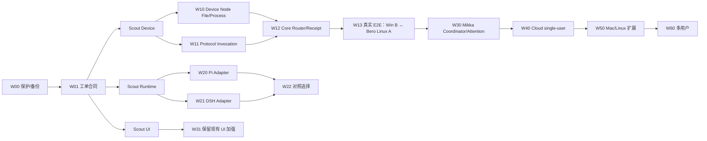

# LOOM Mikka-first 开工工单（Pi Skill 可派发版）

> **历史归档 / RETIRED_WORK_ORDERS / 不再作为 Core V2 施工指令。** 用户最新要求「本轮只整理架构、不开工」，后续唯一入口：[LOOM V2 总计划](../plans-2026-11-18/LOOM-V2-MASTER-PLAN.md)。此文件原始正文与当时测试结论仅作历史证据；原字节 SHA256 快照在 [历史归档](README.md)。**不得依据下文旧“已授权开工/唯一入口”重新派工**。

> **最新用户授权：允许实施。** 旧 `pi-work-orders-architecture-proposal-2026-11-15.md` 的 NOT AUTHORIZED 属历史讨论状态。工兵仍遵守本文件安全与 owner 范围：Windows 本机不运行 Claude Code，不动原 64851/原生产 DB，不读/回显 key，不全仓 reset/clean。

## 协调约定
- 主控 AgentDock 任务 `tsk_407c504cc8494d6d`，每一工单必须有 `TaskID / Phase / Owner / Input / WriteAllowlist / Dependencies / Test / Evidence / Rollback / Handoff`。
- 模型 `oct-chat/deepseek-v4.1-flash`、`max`；无可用真模型就标 BLOCKED，不自动换别的模型。用户同意使用 Pi 渠道已有 API 配置，但只能由受管 CLI 在进程内读取，绝不打印 key。Pi Skill doctor 的 models.json 与 DSH 设置存在漂移，**须先实际验证模型行为**。
- 本 Windows 受管宿主有进程 Job 生命周期：用 `pi_skill_cli.py run` 放在 AgentDock `exec_command(execution_mode=async)` 管理的会话里，**不使用裸 `start` 假后台**。用 `session_observe` 和 Pi `status` 追踪；不改宿主 Job/计划任务。
- 开工读：`AGENTS.md`、`docs/README.md`、`docs/versions/README.md`、`docs/architecture/cross-host-execution.md`、`docs/contracts/workspace-rpc-v1.md`、`docs/loom/loom-mikka-first-execution-plan-2026-11-15.md`，Mindkit `PROJECT_ID.md` / `TASK.md`。
- **只读 first**：Scout 出具体改动方案；主管复核后把唯一目录给单 Worker。不得让多工兵同改 `lib.rs`、`session.rs`、`nodes.rs`、`product.css` 等共享文件。Node 三个 WIP 文件必须同一 owner。
- 每个 Worker 使用独立 Git worktree 或隔离副本；不动主仓五个 WIP。生产改动必须经主管 reviewed diff、测试和人工接受流程；分支/PR 不得静默 push/merge。
- 工兵完成 `DONE_AWAITING_APPROVAL` 非 ACCEPTED。主控独立验测试用例后通过 `approve --verdict accepted|returned|rejected`，保存 run id + 证据。所有 Agent 只可在授权范围读写。

## 实施 DAG


## 第一批立即可做（保护 + 真实落地）

| TaskID | owner/允许修改 | 输入和边界 | 输出 | 测试/门槛 |
|---|---|---|---|---|
| **W00** | 主控；只写 `_artifacts/loom-execution-20261115/` | 看 Git 5 WIP、7 旧文档、64851、Mindkit guard | WIP patch + sha、原文备份、运行身份 | hash/状态对齐，不重启 |
| **W01** | 主控；只写新 `docs/loom/loom-mikka-first-*2026-11-15.md` 和根 Mindkit 顶部 | 现有深读源码/Deep Research 结果 | 架构、任务/验收、进度、通俗版 | 真实文件 readback、文档链接可解析 |
| **S01** | Pi scout，只读 `crates/loom-node`、`crates/loom-protocol`、`crates/rovai-web` | R1/R2和历史 device-only WIP | 完整 Device 调用链与最小变更清单 | 至少 8 个源代码锚点 |
| **S02** | Pi scout，只读各 adapter / Pi+DSH 参考镜像 | 深读 Pi Skill/DSH Cordis/协议 | 最小 RuntimePort 改造及真实模型条件 | 输出真实 source anchor |
| **S03** | Pi scout，只读 Renderer/UI 规则 | 现 Hero WIP 与 reference UX | 最小 UI diff/回归范围 | 品牌图未获取明确标阻塞 |
| **W10** | **Node Owner**；独占 `crates/loom-node/src/{lib.rs,session.rs,process_wire.rs}` 与相应 Node 测试；写在独立 worktree | 从备份 patch 恢复历史 WIP；Device-only 模式当前 1 失败 | B 无模型安装时能复用现有 transport 接入；先 bounded read+git status，增单命令 allowlist、输出上限、cwd binding、timeout | `cargo test --offline -p loom-node --lib` 真全绿；10053 失败说明/修复；禁止任意未受控 shell |
| **W11** | **Protocol Owner**；独占 `crates/loom-protocol/` 新独立文件和测试 | W01 的 envelope/Grant/receipt 字段；先不修改已有 wire 共用类型 | `Invoke/Receipt` typed message spec 及 version/capability/no-grant negative | 序列化、未知版本拒绝、deadline/duplicate replay 测试 |
| **W12** | **Core Integrator Owner**；独占 `crates/rovai-web/src/nodes.rs`，跨模块注册文件由主控 | W10/11 通过后 | Goal->DeviceInvoke->Receipt->Artifact 路由，主控审批和设备复验双门 | 与独立 Node 实际 E3/E4，同 Device 有/无 Grant 和多租户拒绝 |
| **W13** | QA（仅隔离 `_artifacts/` 和测试用数据根）/主控 | Bero via Komari、Win B Node、cloud A Core；用户当前 64851 不动 | `T2,T3,T4,T5,T6,T7` 真实网络/磁盘/回执 | B 无 Pi/DSH/Codex，日志含设备ID+invocationID，回执归档，不是 fixture AST |
| **W14** | QA/主控，无产品写 | 原 54/1/2 Node 回归与双 Node fixture | 失败复现最小化，真实跑 T0–T7，区分模拟与物理设备 | 无 FAIL/NOT_RUN 冒充 PASS |

## W12 实证后修订（2026-11-15）

W12 Scout 与 Worker 已完成：**Device-only 的 E3 文件通道与旧 Runtime evidence 通道不是同一路**；旧 `agent_run_execution_target` 又强制真实 CLI installation，不能安全用两文件 `remote_artifact.rs/application.rs` 变更完成 E4。原 W12 单人改造宽泛工单视为 `BLOCKED_SAFELY`，不得假填 `FrozenRunTarget`。请使用新 [W12A Domain/Schema、W12B Device Transport、W12C Artifact Integrator、W12D QA](loom-mikka-first-device-invocation-seam-2026-11-15.md)。各文件 owner 独占、变更 feature gated、旧运行服务不动。候选 `worktrees/core` 中的权限增强尚未编译测试，不可合并或报 E4 PASS。

## 第二批独立并行（不阻塞 W10–W13）

| TaskID | owner/写范围 | 输出 | 验收门槛 |
|---|---|---|---|
| **W20** | Pi Owner，新 `crates/rovai-core/src/runtime_ports/pi.rs` 或单独 spike 根 | 内置 Pi RPC/stream/cancel/recover、4 类能力 loaded/invoked | 同 DeepSeek max 真 Run，不能只依据安装路径 |
| **W21** | DSH Owner，新 `packages/loom-dsh-host/` 或单独 sandbox 根 | DSH Cordis official host/插件/会话/授权 sandbox | Bero gVisor/runc 按需要隔离，独立 home，Windows 不测 Claude |
| **W22** | QA Reviewer；只写忽略的 `_artifacts/` 数据 | 100+ 固定任务 Pi/DSH 成功率、latency、费用、修复率 | 同 Repo/模型/权限/时间，真数据才选默认 |
| **W30** | Coordinator Owner，`crates/rovai-core` 中独立 event/outbox 模块，注册由主控 | 事务事件→commit→wake→triage→dispatch→needs-you→review | crash/restart/duplicate/approval 拒绝 E6 |
| **W31** | UI Owner，独占 `apps/desktop/src/renderer/src/loom-native/Inspector.tsx` + `product.css`，从 UI WIP 继承 | Hero 上 1/3、Bot/Group identity、低成本眼动、边栏拉伸；待图片三再做品牌 Logo | 原 30 定向 + 全部相关 Vitest/typecheck/真实页面；无图片不得伪造 |
| **W32** | Capability Owner，独立资产/桥接模块 | Skills/MCP/Rules/Hooks + Memory 分离，冻结版本与实际生效回执 | discovered→selected→loaded→invoked→evidence |
| **W40** | Cloud/Release Owner，仅独立部署目录+隔离数据根 | Linux Cloud Core + 单用户账号 + Device Pairing Web | 重新登录跨设备 Bot/Goal/Memory 不丢；不切日常 DB |
| **W50** | Mac/Linux 各平台 Owner，独立 platform driver | TCC/Screen/PTY/Wayland/X11 capability，权限诚实降级 | E5 真平台设备实测 |
| **W60** | Tenant/Security Owner，新增 AuthZ/tenant 隔离测试 | owner/workspace/tenant 全链 | 两个用户互不可见 Bot/Memory/Device/Grant/Artifact |

## 独立 Git 工作区规则

```text
main worktree = 用户当前 LOOM，五个历史 WIP 继续保留
_artifacts/loom-execution-20261115/worktrees/node  = Node owner
_artifacts/loom-execution-20261115/worktrees/proto = Protocol owner
_artifacts/loom-execution-20261115/worktrees/runtime-pi = Pi owner
_artifacts/loom-execution-20261115/worktrees/runtime-dsh = DSH owner
_artifacts/loom-execution-20261115/worktrees/ui = UI owner
```

新 worktree 以锁定 HEAD 创建、继承相应 WIP 的 **特定路径 patch**，与主管集成前不得用全仓 checkout 覆盖。每个 worktree 的 `AGENTS.md`、current version/contract 权威不变。

## Bero 使用条件

`berobox` 提示 Bero 别名经 `komari-ssh` 进机，Docker/runc 编译我们自己的项目，第三方/未知代码用 gVisor runsc。任何代码/模型运行在专用临时目录/容器，**不得挂载宿主 SSH/key/home**；禁止把 Docker 端口暴露公网、禁止 `prune`。KOMARI ticket 用完即烧，结果未知不重发。Bero 环境身份以真实 CLI probe 为准。

## Handoff 模板（工兵和主控通用）

```text
TASK_ID / PHASE / OWNER / BASE_SHA
INPUTS / WRITE_ALLOWLIST / RULES_READ
CHANGED_FILES (exact path)
RESULT: PASS | FAIL | PARTIAL | NOT_RUN | BLOCKED
EVIDENCE: source anchor, git diff, sha, log path
CHECKS: actual command + exit + OS/device identity + data root
NEGATIVE_TESTS: denied, stale epoch, unknown result, bad path
ROLLBACK: feature flag / exact commit / snapshot
CURRENT_RISK / OPEN_QUESTIONS / NEXT_OWNER
PR / COMMIT: optional, explicitly accepted only
```

**精力顺序**：W10/W11→W12→W13 是主线；不要为了 W22 bake-off、T17 enterprise、UI 图三等待而延误 T2/T4 可用闭环。源码已就绪不代表真设备验收，必须更新 `loom-mikka-first-acceptance-2026-11-15.md` 的每一项实测事实。
