# LOOM 方案 B 终态界面规格（2026-11-01）

> 给设计主管看的界面规格。只定终态界面。这一份不改 Rust、不改渲染器、不改数据库，也不打开任何生产入口。
>
> 第 9 节的 12 条已于 2026-11-01 由界面主管决定。第 7 条按主管的改法执行：有在途 Run 的作废必须输入节点名；空闲节点仍是普通确认。
>
> 方案底稿是 [方案 B](plan-b-a-controls-b-2026-11-01.md)、[参考仓库](references-plan-b.md) 和 [方案 A](plan-remote-2026-10-31.md)。视觉沿用 [DESIGN.md](../../DESIGN.md) 和 [UI 规范](../ui/README.md)。日间是 Porcelain Day，夜间是 Steel Night，色值用现有语义 token，不新加一套皮肤。
>
> 可点击原型在 [docs/loom/ui-prototype/index.html](ui-prototype/index.html)。数据全是样例，每一帧右上角有「样例数据」。查询参数可以钉住一帧：`?screen=live&state=offline&theme=night&shot=1`。`shot=1` 收起原型自己的底栏。重新出图：`docs/loom/ui-prototype/capture.sh`。

选静态页，是因为这次不能改生产行为。仓库里的 `docs/prototypes/` 被 Git 忽略，不能当评审材料提交。开发路由会碰到渲染器模块，所以不走那条。

## 1. 信息架构

人打开的仍是连在机器 A 上的那一套 Rovai / LOOM。桌面和 `rovai-server` 的网页共用渲染层，下面这些入口两边一起出现。

一份 Core 管三样新事实：

| 事实 | 住在哪 | 人在哪看 |
|---|---|---|
| 执行节点 | A 的节点表。B 没有库 | 设置 → 能力 → 节点 |
| 项目文件 | 工作区主人那台节点的磁盘。A 只转发读、列、写 | 使命会话的文件预览前导列 |
| 队员目录 | 勾选存在 A。Run 开始前打成运行包送到节点 | 队员页里这个队员的目录 |

一次使命仍是现在的三个分段：活动、编排、交付。编排里多一个阅读方式：**派遣**回答「这段活为什么在这台机器」，**现场**回答「现在输出到哪一号」。活动历史和交付列表不另做。

放置按「一段活一个文件主人」来画，不是把同一个目录拆到两台机器上。样例使命 `M-014 节点通道` 里有三段：

| 任务 | 队员 | CLI | 主人 | 理由 |
|---|---|---|---|---|
| 拆节点协议 | 织 | `claude-code-cli` | loom-a，本机 | 文件从一开始就在 A，本机有这个 CLI |
| 在 B 上跑通心跳 | 梭 | `codex-cli` | desk-b | 工作区已经钉在 B，不能改派 |
| 对照输出序号 | 验 | `claude-code-cli` | loom-a | 读的是已经回到 A 的回放，不打开 B 的目录 |

第三段等第二段的产物被人工验收后才放行。这是现有的 `artifact_accepted`，不是新的批准制度。

## 2. 导航变更

不增加一级侧栏。品牌、项目、会话、设置返回都留在现在的壳里。见 [App Shell](../ui/components/app-shell-navigation.md)。

1. **设置 → 能力**，在「远端主机」后面加「节点」。Desktop、Web、独立 Server 都显示。节点属于当前连上的这份 Core。
2. **远端主机**不动，仍只在 Desktop 主窗口。它打开的是另一台机器上的整套 LOOM。节点没有自己的库。两个入口的差别写在节点页第一段，并链到远端主机。合同仍是 [远程连接](../ui/host-remote-connection.md)。
3. **队员页**增加这个队员的目录。全局的 MCP、Skills、工具箱设置继续是定义从哪来，不把目录搬进设置分类。
4. **文件树**是文件预览分栏的前导列，不是第四个 Loom 分段。点文件仍进 `FilePreviewPane`。
5. **编排**分段里加「派遣 | 现场」。活动、交付两个分段保持现在的职责。

远端主机的现有页，原型里只作对照，不在这次改：

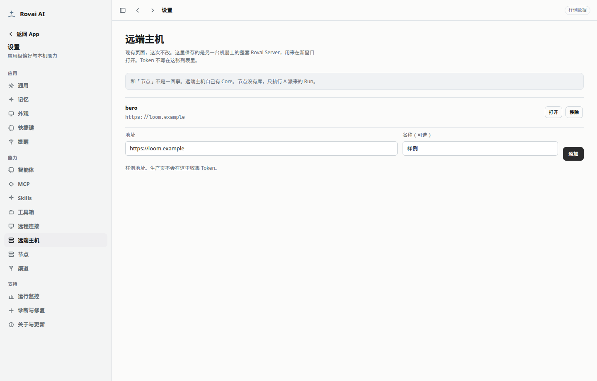

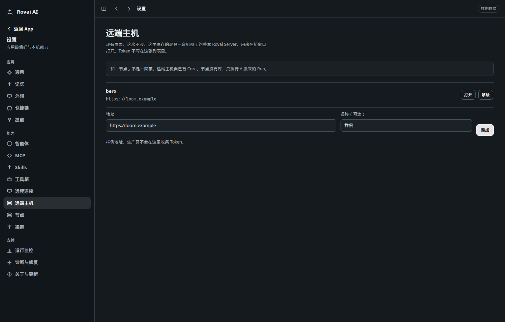

## 3. 节点

设置页。左栏是现在的设置分类，右栏是一列节点。本机和拨入的机器用同一行。

一行上有：名字、角色（本机 / 家里的电脑）、在线或离线、操作系统和架构、最后心跳、上报的 CLI 和版本、正在跑的 Run 数量。展开之后才是节点上的路径和路径状态。路径是那台机器上的字符串，A 不打开它。离线行保留上次上报，状态写「上次见到」，不改成路径缺失。

本机节点没有作废。它跟这份 Core 走。「添加节点」打开对话框：一次性配对码、`wss://` 地址、可以复制的 `loom-node` 命令。码 10 分钟有效，用过即废。对话框不显示节点令牌。作废在该行上。空闲节点是普通确认。节点上还有在途 Run 时，必须输入节点名，对上之后作废才可点。两种确认都写明：令牌失效，在途进程由节点自己杀掉并上报，磁盘上的文件还在，只是不再派新 Run。

| 状态 | 画面 |
|---|---|
| 就绪 | 本机在线，一台远端在线并展开 CLI，一台远端离线且保留上次 CLI |
| 空 | 只有本机。文案是「还没有拨入的节点」，不把本机藏起来 |
| 读取中 | 标题还在，正文是「正在读取节点…」。不放进度条 |
| 失败 | 从未读成功时不画节点，避免把失败看成空列表。已有列表时生产应保留上次成功的行，并在上方报错 |
| 离线 | 正在干活的 desk-b 心跳没了。在途 Run 不改派。新 Run 不派给它 |
| 配对 | 就绪列表上的对话框 |
| 作废 | 有在途 Run：输入节点名。空闲：普通确认 |

复用：`SettingsSidebarNavigation`、`SettingsPageHeader`、`RemoteHostsSettings` 的行和 `quiet-button`、危险按钮、`LoomEmpty` 的三根竖条、现有对话框（一层浮面、一个标题、页脚只有动作）。

交互：展开 CLI 路径；复制命令；作废确认（有在途 Run 时输入节点名，空闲时直接确认）；Escape 关闭对话框；本机行的作废按钮禁用，并写「不可作废」。

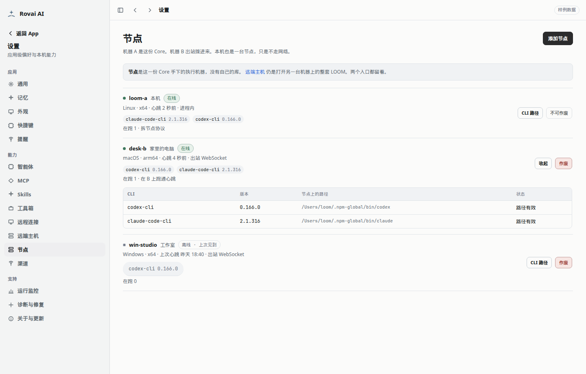

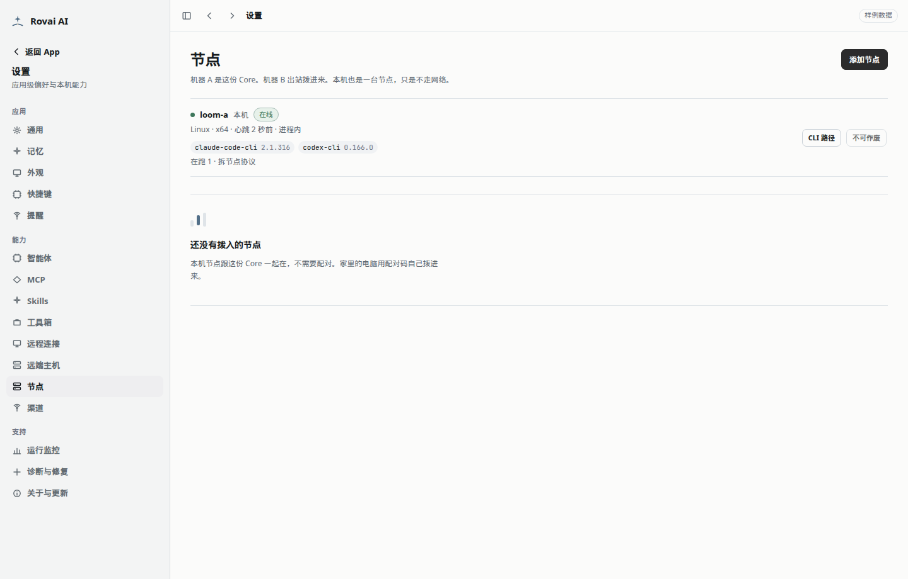

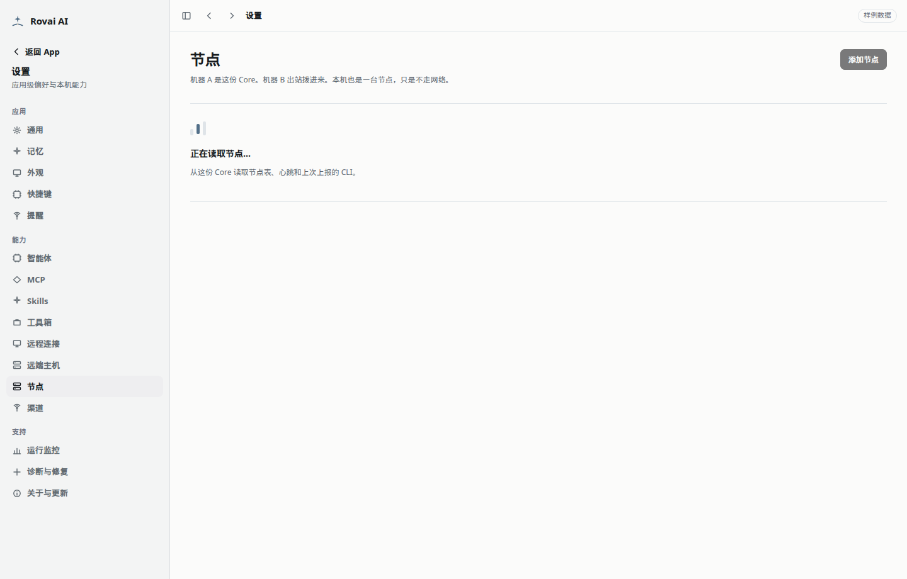

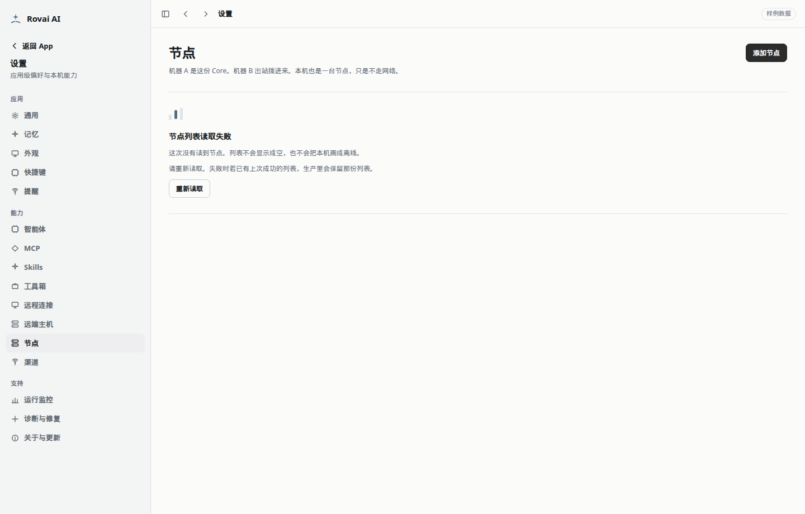

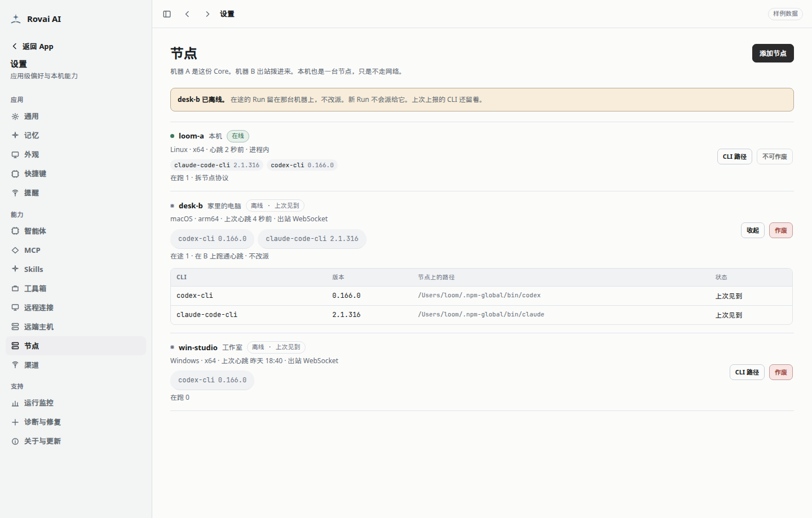

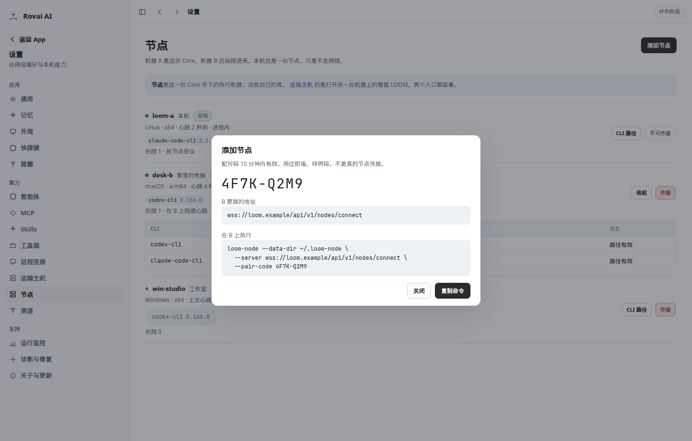

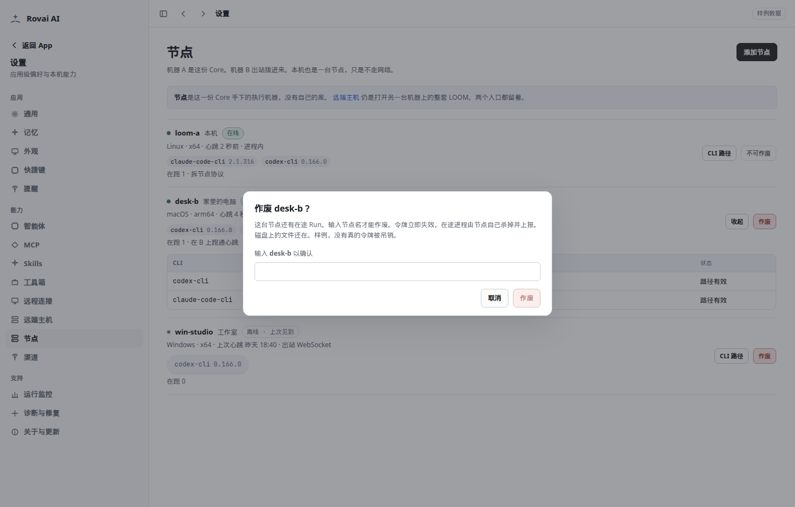

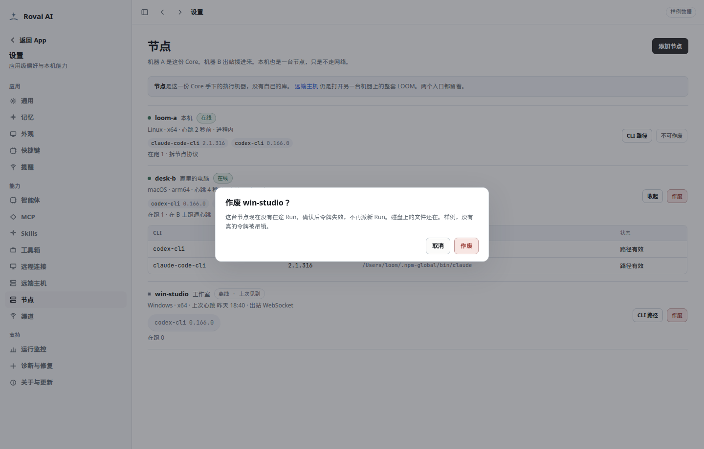

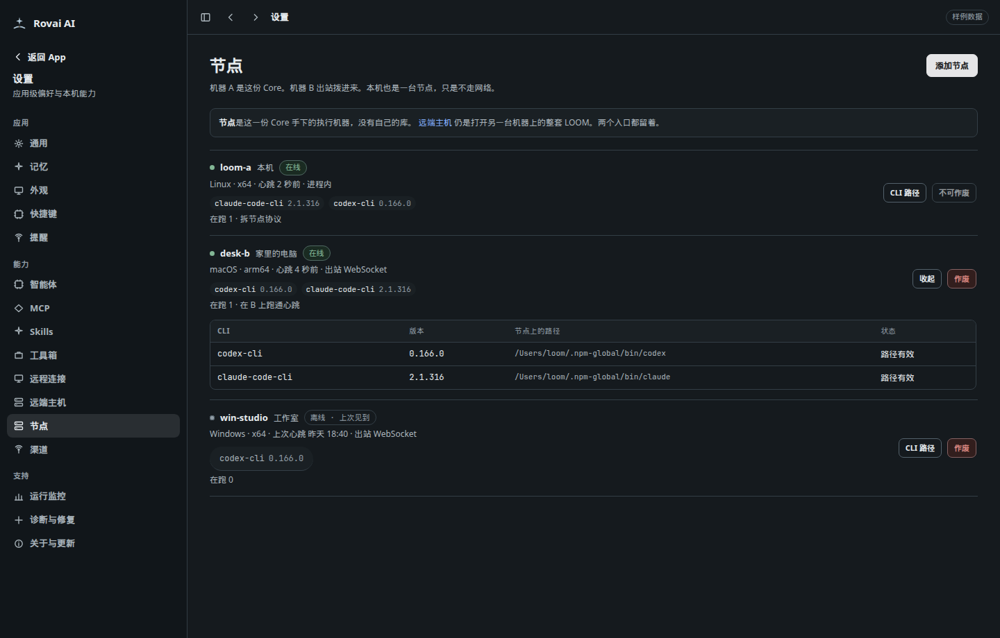

夜间的空、读取中、失败、离线、配对、作废同一布局，帧在 `ui-prototype/screenshots/nodes-*-night.png`。

## 4. 项目文件夹

使命工作区里，文件预览的左边加一棵树。根是当前工作区，数据来自主人节点。点文件打开现有预览：行号、等宽、只读为主。工具条上的「编辑」切到同一份正文的文本区，并写明改动不会在这一步送到节点。生产里的写入仍走主人节点上的文件 API，而且路径必须落在工作区根里。

树顶是「在文件中搜索」，按路径和文件名过滤，搜到的文件会把折叠的目录展开。预览上方是面包屑，从工作区根到当前文件。树上的 `M` / `A` 只标 Git 状态。变更正文继续用现有执行变更，不另做第三种 diff。树底写分支、改动计数和主人是谁。

| 状态 | 画面 |
|---|---|
| 就绪 | 树、选中文件、Git 计数、主人在线 |
| 空 | 根在，目录是空的。文案说明这是空目录，不是读不到 |
| 读取中 | 「正在从主人节点读取…」。不先画一个空目录 |
| 失败 | 「列出文件失败」。主人在线，但树没有读到。可以重新读取 |
| 离线 | 树的位置写「这台机器不在线」，不列成空文件夹。已经打开的标签留着上次内容，标成旧的。编辑按钮禁用，旁边写「主人离线，不能编辑」 |

复用：`FilePreviewLayout`、`FilePreviewTabs`、`FilePreviewPane`、代码和 Markdown 预览。合同仍是 [文件预览](../ui/components/file-preview.md) 和 [会话工作区](../ui/components/conversation-workspace.md)。

交互：搜索文件；展开目录；点文件换预览和面包屑；预览 / 编辑切换；从现场的产物「打开」跳到这棵树上的同一文件；主人离线时编辑停用。

宽屏上这列建议 260px，接在现有预览分栏前面。工作区窄到现有门槛时，沿用「预览替换会话」，树跟着预览走。原型为了看清这列，把树和预览铺满工作区，顶上留「项目 | 编排」。

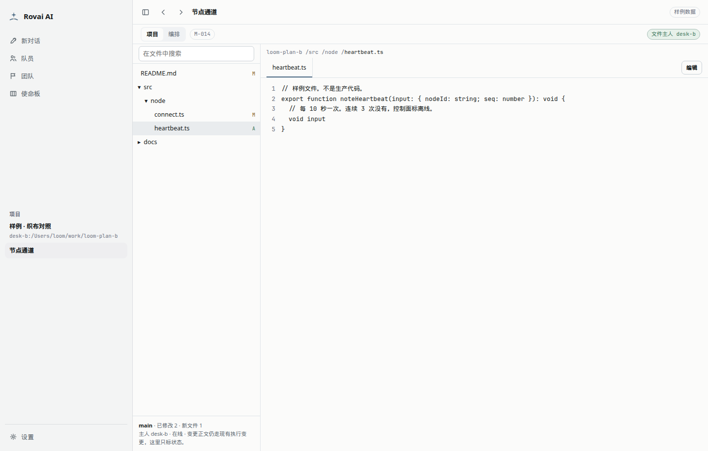

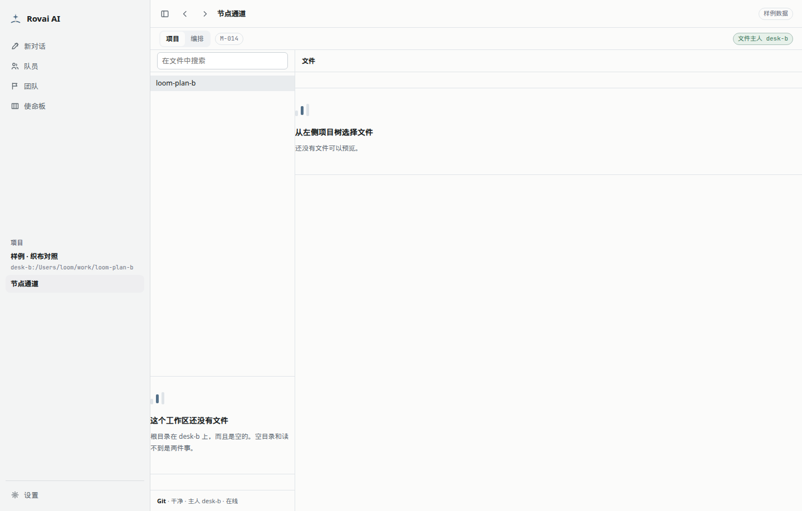

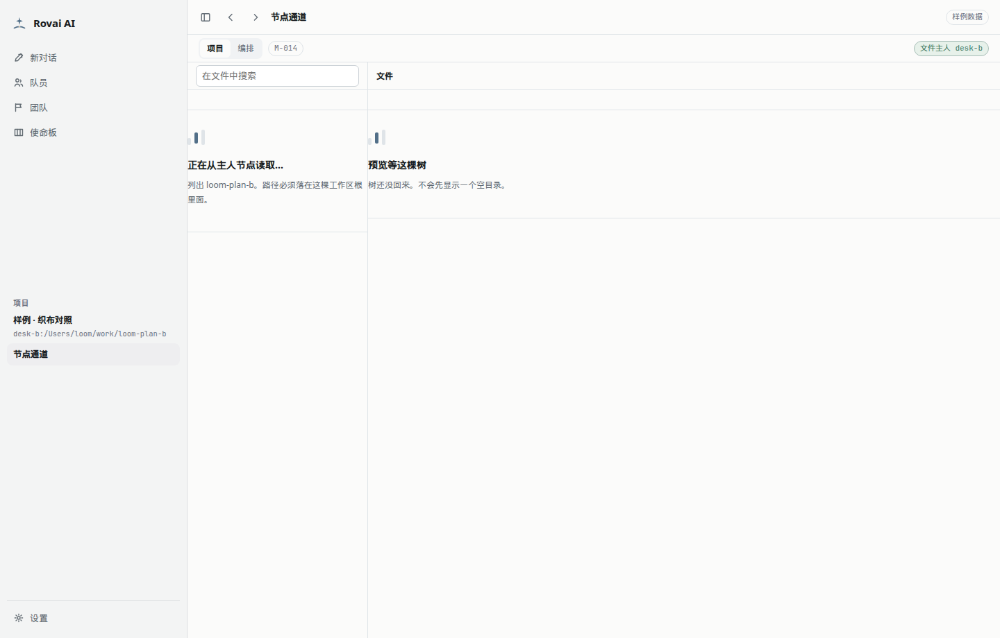

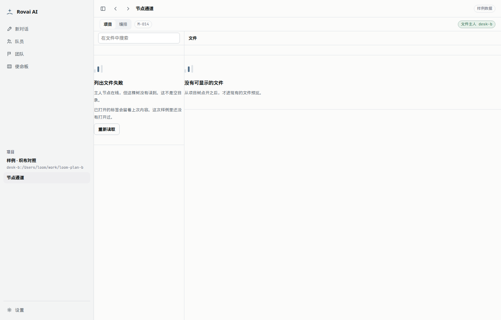

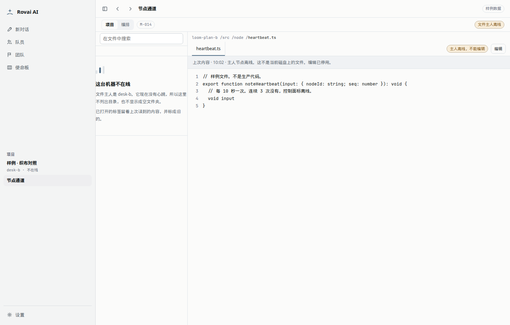

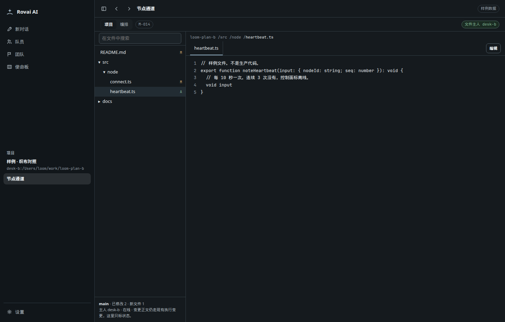

## 5. 助手能力目录

一个队员一页，四个分组，都在 A 上。页首是这个队员的 CLI / 运行时，以及目标节点。节点下拉里，离线的、没有上报这个 CLI 的，不能选，并写原因。

| 分组 | 怎么勾 | 空的时候 |
|---|---|---|
| 技能 | 现有工具箱五项：`campfire`、`grill-duo`、`grill-duo-with-docs`、`member-studio`、`review-duo`。勾上即存，失败回滚 | 五项仍在，只是都没勾 |
| MCP | 全局服务器，这里只决定这个队员用不用。高风险沿用 `acknowledge_high_risk`，取消则勾选不留下 | 「还没有 MCP 服务器。」定义仍在设置里的 MCP 页 |
| 规则 | 身份六段留在队员身份里，这里只给入口。另外是可复用片段，勾上的进下一次运行包 | 「还没有可勾选的规则片段。」六段文字仍会随运行包出发 |
| hook | 新分组 | 「还没有可勾选的 hook。」不放一排永远空着的开关 |

来源写在行右：工具箱、全局定义、规则目录、hook 目录。搜索按名称和来源过滤，没有匹配就在该组写「没有匹配的条目」。

冲突先按名字：样例里 `filesystem` 和规则片段「只读工作区」都要占用 `read_file`。已经同时勾上的，两行都标出来。新勾上的一条若会造成冲突，当场回滚。读取失败时不把勾选画成未选，避免一次失败看起来像全部取消。

页底一条固定摘要，不跟着列表滚走：「下次运行生效：2 项技能，2 个 MCP，1 条规则，1 个 hook · 1 处冲突」。有冲突时「保存」不可用。没有冲突时，保存才把勾选写回 A，从下一次 Run 的运行包生效。工具箱设置页原来的「勾上即存」留在设置里，不搬到这一页。

某一项在某台节点上没有程序时，行下写出来。样例是 filesystem：「desk-b 上没有这个 MCP 程序」。这不阻止勾选，因为勾选存在 A；它只说明那台节点现在跑不了这一项。

目标节点离线时，勾选仍可改。页上写明现在不能在那台机器上启动。

复用：队员名册（内容区左侧，全局侧栏仍在）、[工具箱逐队员勾选](../ui/components/skills-settings.md)、`McpSettings` 的高风险确认、[队员身份](../ui/components/member-identity.md) 的六段文字。不新做一套复选框样式。勾选用当前主题的 action 色，不用系统蓝。

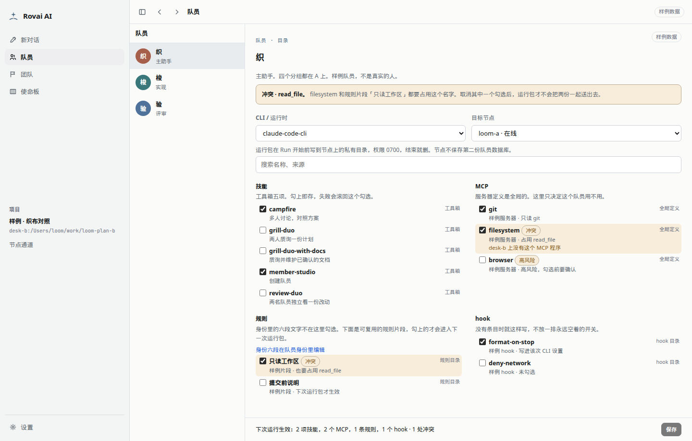

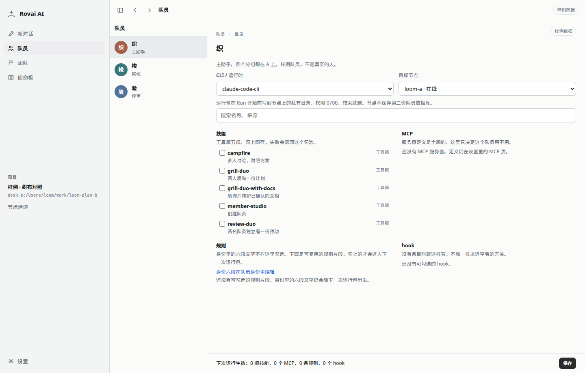

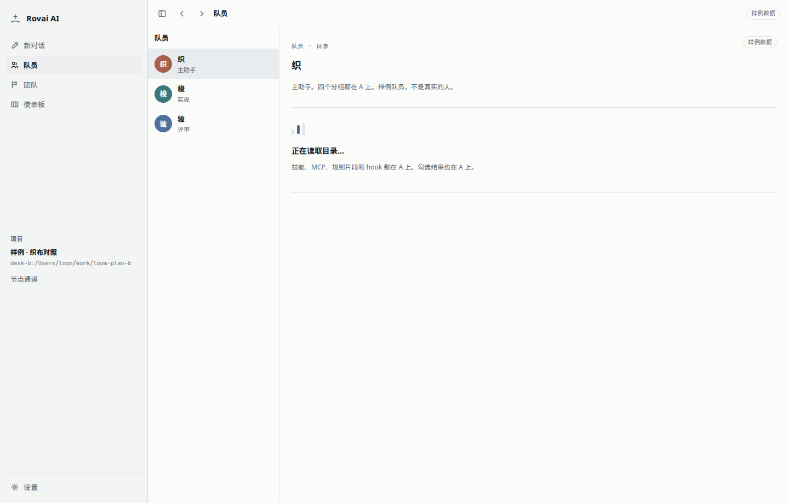

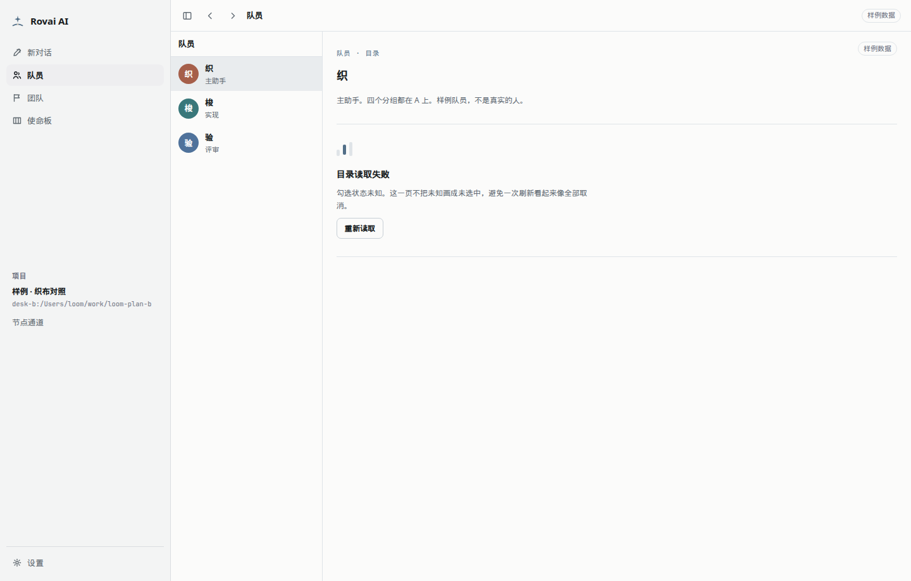

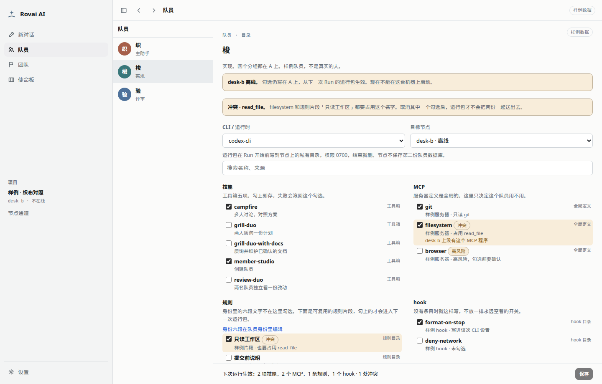

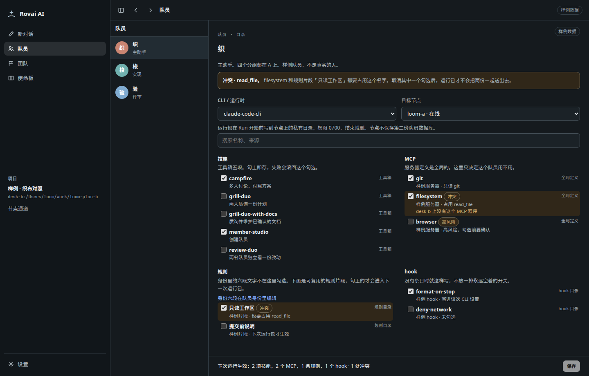

## 6. 使命派遣

编排分段的「派遣」。上面仍是现有的阶段泳道：任务完成放行、需人工验收放行、当前阻塞，三条图例都在。卡片上增加节点名、CLI、在线或离线，以及一行放置说明：有没有这个 CLI、是不是工作区主人、当前负载。认领、租约、fence、阻塞原因留在卡片底部。被挡住的卡片有「阻塞于 …」，点了跳到挡住它的那一段。

所选节点离线时，卡片上写「所选节点离线」，页顶再有一条说明：文件不在别的机器上，不能改派。

点一张卡片，下面用完整句子再答一次「为什么在这台机器」，并列出每台节点能不能选。不能选的单选禁用，原因写在行下：离线不接新 Run、没有这个 CLI、这份工作区的主人不是它。已经钉死的主人不能从这里改到另一台。

| 状态 | 画面 |
|---|---|
| 就绪 | 三段活、两台在线节点、一台离线节点，以及选中任务的理由 |
| 空 | 现有文案「尚未配置编排」，下面三格是当前使命、队员数、执行中。计数是 0，不借用就绪数据 |
| 读取中 | 「正在读取编排…」 |
| 失败 | 「读取编排失败」，可以重新读取 |
| 离线 | 主人 desk-b 不在。这段活不改派，单选里写明文件不在别的机器上 |

复用：`LoomWorkspace` 的分段、`loom-flow` 的阶段列和卡片、认领行、`LoomEmpty`、`loom-foundation`。见 `apps/desktop/src/renderer/src/LoomWorkspace.tsx`。

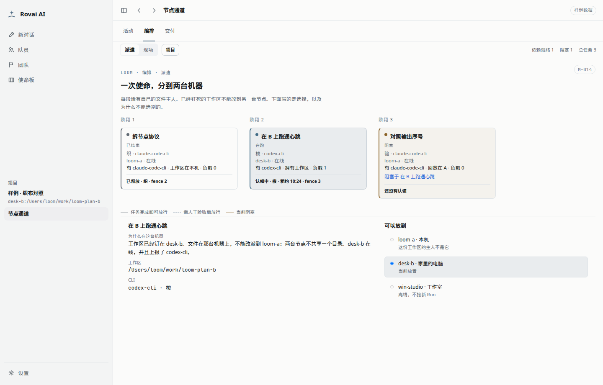

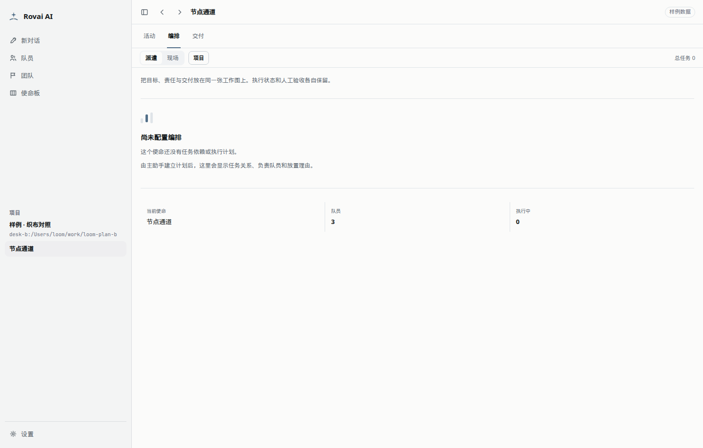

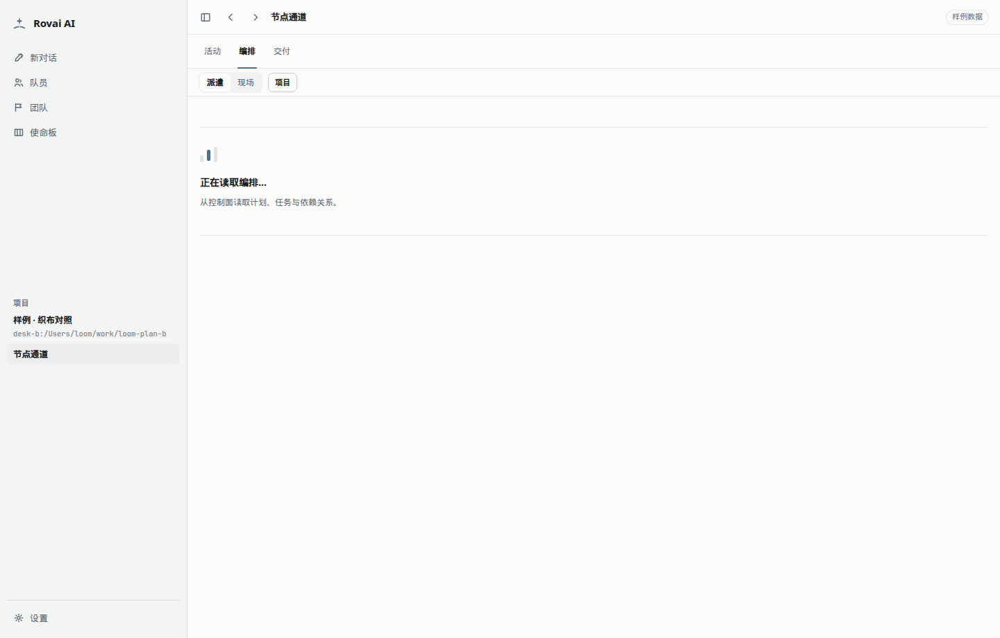

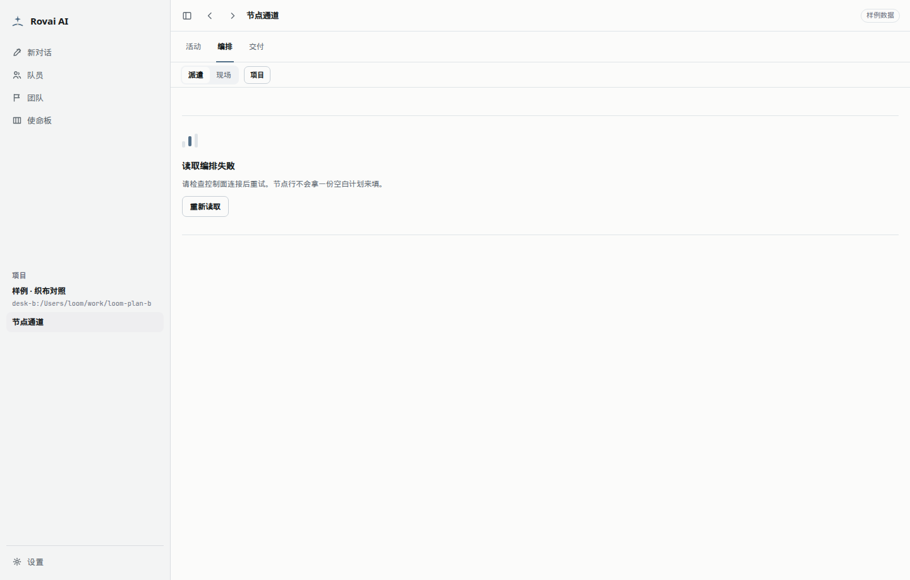

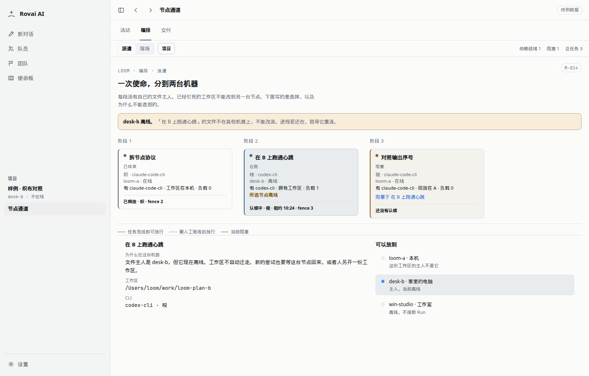

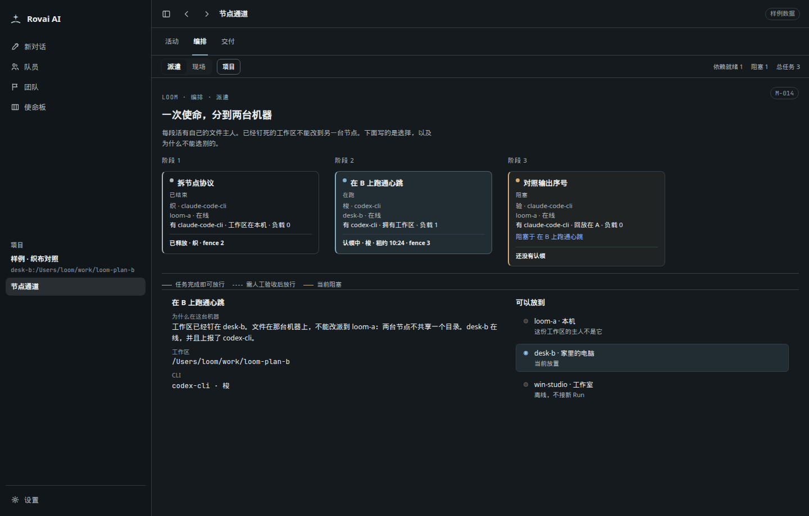

## 7. 现场进度

这是终态里最密的一屏，仍在编排分段里。左边从上到下三块：依赖图、节点泳道、事件。右边是每一路 Run 的终端，不是只开着当前这一路。

依赖图回答谁等谁。卡片上有一条细的进度：已结束是满的，在跑的写已进行多久，被挡住的是空的，并有「阻塞于 …」。点那一行，选中挡住它的任务。

节点泳道回答哪台机器上的哪一段输出。时间轴右端是「现在」。在跑的条子右端停在现在之前，交互时继续往现在长；截图停在样例的 10:18。离线泳道用斜线，不画一条假进度。断线的在途 Run 用虚线停在断线前，现在线仍在右端。

泳道下面是事件：认领、fence、产物、心跳丢失、心跳恢复、评审。每行有时间。可以按节点或任务过滤。

右边每一路 Run 一个标签：节点芯片、运行时、已进行、最后输出距现在多久。标签下面可以切「全部 / stdout / stderr」，以及「跟随最新」。序号跳号时插一条「漏了 3 行，正在补齐」，不把整段日志重画。样例停在序号 148。「追加一帧」只在这页上加一行。断线时最后一行写「已确认到序号 148 · 进程还在 · 不另起进程」。没有 Run 时终端不伪造输出。

产物在终端下面。点「打开」去项目树。验收通过 / 退回修改写的是现有评审。没有产物时按钮禁用。连接断了，已经送回的产物仍可验收。

认领读失败时卡片写「认领状态未知」。这不是「没有认领」。其他任务、事件和输出还在。对应 `claims === null`。

动效只说明状态，不推动布局：

- 在跑的状态点轻微明暗，大约 1.8 秒一轮，不改尺寸。
- 新的一行输出 180 毫秒淡入。行高先占好，不把上面的行挤开。
- 在跑的泳道条只在轨道内部变长，不把事件列表顶下去。
- `prefers-reduced-motion: reduce` 时停在终态：不脉冲、不淡入、不伸长。
- 出图用的 `shot=1` 同样停住，避免截到半帧。

| 状态 | 画面 |
|---|---|
| 就绪 | 依赖图和进度、三条泳道和现在线、事件、多路终端、漏行提示、产物、验收 |
| 空 | 图可以先在，终端明确写还没有执行 |
| 读取中 | 「正在读取现场…」。某一路失败时生产应留下其他路；这一帧演示的是整页还没读到 |
| 失败 | 「执行过程读取失败」 |
| 离线 | desk-b 斜线泳道，输出停在已确认序号，事件里有心跳丢失 |
| 认领未知 | 依赖、事件和输出都在，认领行不明 |

复用：同一张 `loom-flow`、图例、认领行；`ThreadWorkspace` 的执行过程；现有产物列表和评审写入口；文件预览的标签条用来排多路 Run。右边的序号和「漏了 N 行」只借 Buildkite 按序号续传，不断线重画整段日志。节点一行一个状态，只借 Woodpecker / Vibe Kanban 的密度。工具和输出现在同一条流里，只借 OpenHands 的事件顺序。不搬它们的组件和样式。

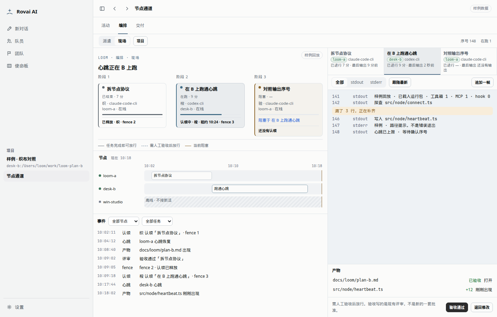

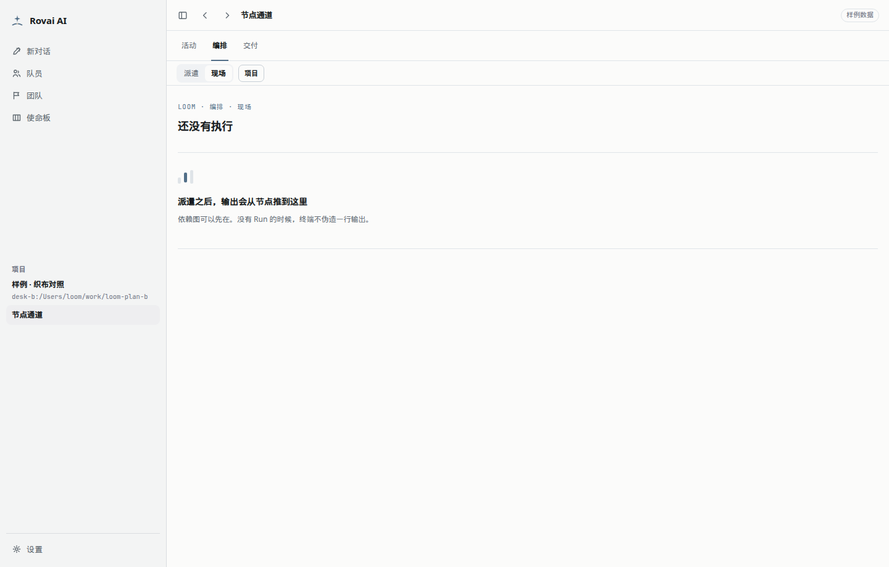

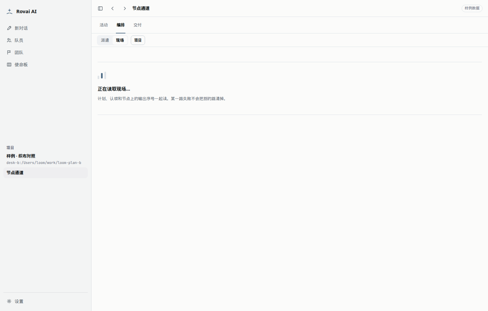

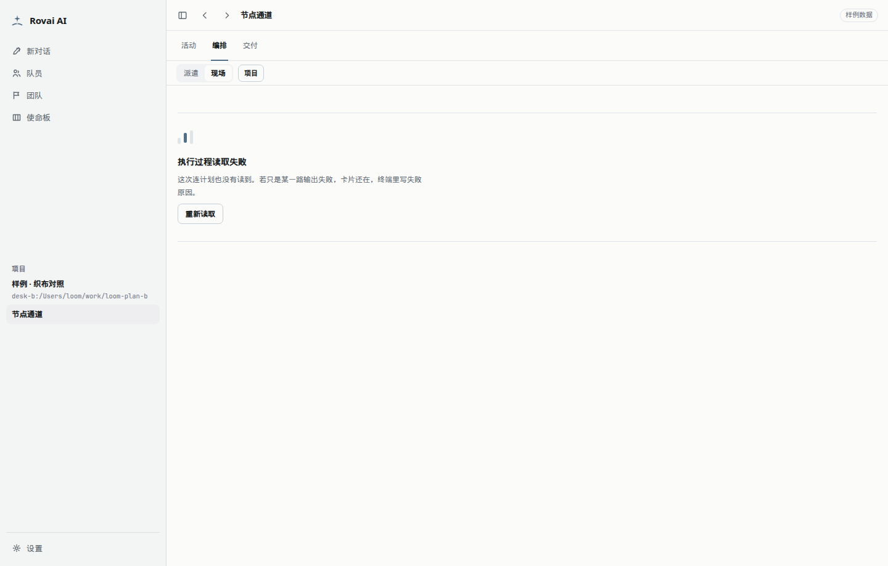

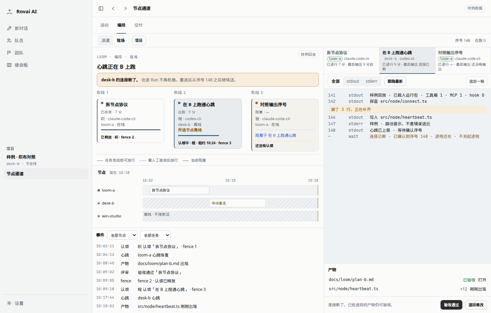

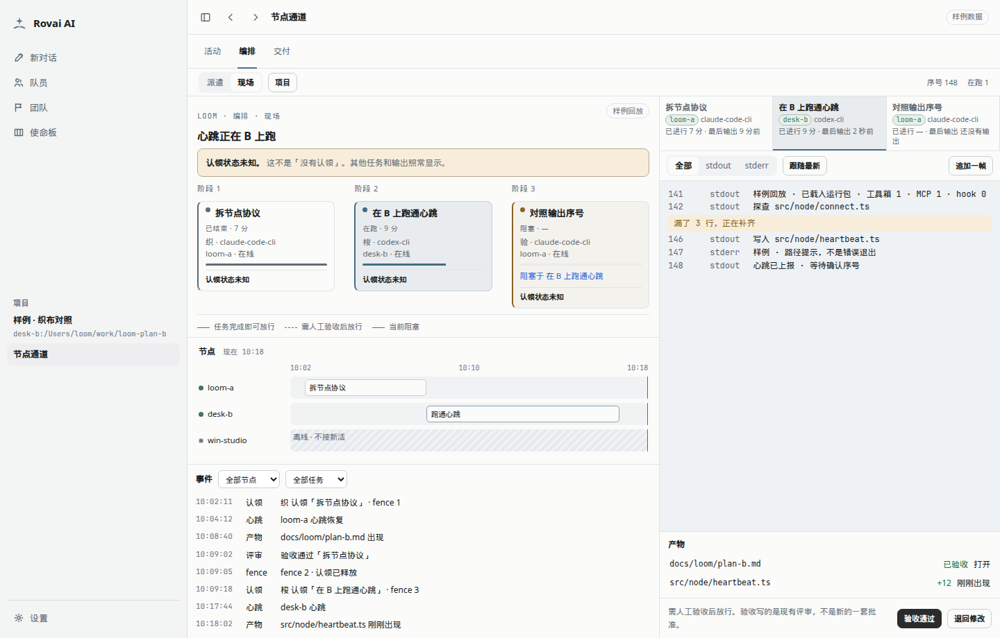

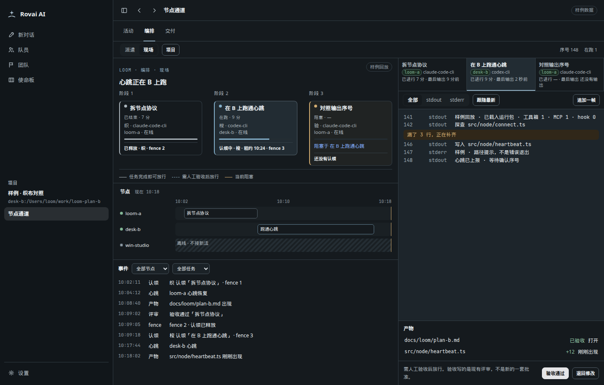

## 8. 组件清单

新的是组合，不是新的控件库。生产实现时应直接用这些现成件，而不是把原型里的 CSS 搬进去。

| 终态区域 | 现成件 | 这次新组合的部分 |
|---|---|---|
| 设置分类 | `SettingsSidebarNavigation`、`SETTINGS_SIDEBAR_GROUPS` | 能力组在远端主机后加「节点」 |
| 节点行 | `RemoteHostsSettings` 的行、`quiet-button`、危险按钮、状态点 | 心跳、CLI 版本、在跑的 Run、路径展开 |
| 配对 / 作废 | 现有对话框、代码块 token | 配对码、一次性命令；有在途 Run 时输入节点名，空闲时普通确认 |
| 空 / 失败 / 读取中 | `LoomEmpty`、`remote-state` | 文案换成节点、树、目录、现场 |
| 项目树 | `FilePreviewLayout` 的分栏和 1px 分隔 | 树、搜索、面包屑、主人、Git 字母 |
| 文件正文 | `FilePreviewTabs`、`FilePreviewPane`、Markdown / 代码预览 | 离线时的「旧的」条，以及禁用的编辑 |
| 队员目录 | 队员名册、工具箱复选框、`McpSettings` 高风险确认、身份六段 | 四个分组、节点缺程序、底栏摘要和保存 |
| 派遣 | `loom-flow` 阶段列、卡片、认领、图例、`loom-foundation` | 每段一行放置说明，离线警告 |
| 现场输出 | 执行过程面板、产物列表、评审动作、文件标签条 | 多路标签、流过滤、漏行、现在线、事件 |
| 主题 | `packages/ui/src/theme.css` 的 Porcelain Day / Steel Night | 无 |

不引入新字体、新图标库、新的状态色。身份色只出现在队员头像上。

## 9. 已决定

DECIDED（2026-11-01，界面主管）。第 7 条是主管改过的决定，其余按原推荐接受。

1. **一个使命可以有多份工作区主人。** 每段活钉自己的目录。同一个目录不拆到两台机器。
2. **节点泳道不是第二张产品图。** 依赖泳道仍是编排。节点泳道是同一批任务按机器排的时间。
3. **宽屏默认展开项目树**，作为预览分栏的前导列。窄屏沿用现有「预览替换会话」。
4. **Web 和独立 Server 都显示节点页。** 节点属于当前这份 Core。远端主机仍只在 Desktop。
5. **目录在队员页。** 设置继续管 MCP、Skills、工具箱的定义。
6. **本机节点不能作废。**
7. **有在途 Run 的作废必须输入节点名，对上才可确认。空闲节点是普通确认。**
8. **钉死的工作区不能在派遣里改到另一台。** 换机器是另开一份工作区再用 git 交换。
9. **冲突先管同一个工具名被两条勾选占用。** 新勾选造成冲突就回滚。已经存在的冲突保持可见，并且不能保存。
10. **现场上的验收写现有评审和 `artifact_accepted`。** 交付分段仍是权威列表。
11. **这轮只覆盖 Porcelain Day 和 Steel Night。** 晨雾、朝霞、绯夜不另画。生产不按主题分叉结构。
12. **未使用且未过期的配对码可以再打开同一次。** 用过或过期就重新生成，旧码不再显示。
